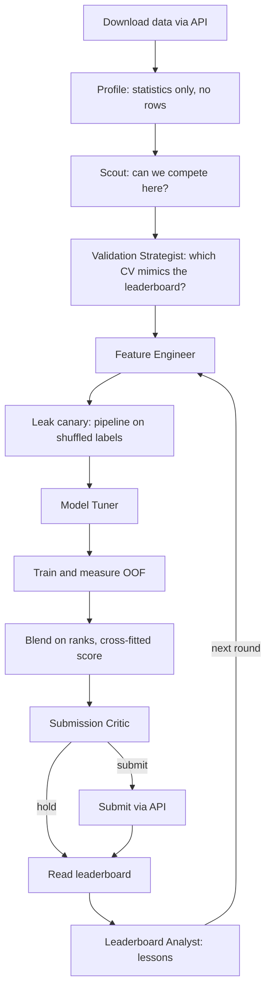

# Kaggle Slayer

A team of specialist agents that takes part in Kaggle competitions on its own: it collects the data,
trains models, submits through the API and monitors the leaderboard.

Built for CloudWalk's Nimbus challenge 1.1. The goal in the brief is the top 20%, and this project aims
for the top 5%.

## Results

Latest public standing, read on 2026-11-06 at 00:36 UTC. Each run's full evidence is in `runs/<competition>/report.md`, generated
from its ledger.

| Competition | Teams | Best CV | Best public | Public rank | Top |
|---|---|---|---|---|---|
| [CloudWalk loan repayment](https://www.kaggle.com/competitions/large-scale-loan-repayment-modeling-challenge) | 12 | 0.75419 | 0.74226 | 1 | 8.3% |
| [Playground S6E11, card fraud](https://www.kaggle.com/competitions/playground-series-s6e11) | 841 | 0.95231 | 0.95202 | 139 | 16.5% |

Both competitions were still open at delivery, so these are public ranks. Final ranks use rows the public board does not
show, and they may differ. Playground's row is what Kaggle shows, which is phase 2 below. API spend across both was US$ 29.29
(Playground 25.46, CloudWalk 3.83).

### Two numbers on Playground

The top of Playground's board rests largely on stacking other people's published predictions. So we measured both sides and keep
them apart.

| | Models | Public | Rank when read | Evidence |
|---|---|---|---|---|
| **Phase 1** | Only models this team trained | 0.95177 | 176 of 841, top 20.9% | `phase1_snapshot` in `runs/playground-series-s6e11/ledger.jsonl` |
| **Phase 2** | These, stacked with 166 published models | 0.95202 | 139 of 841, top 16.5% | `runs/playground-series-s6e11-public-pool/ledger.jsonl` |

Kaggle shows a team's best score only, so the public board shows phase 2. **Phase 1 is the result of the agent team, and it is the
number that answers the brief.** On that reading it missed the brief's top 20% by 0.00011, less than one standard deviation of
the board's noise between two models ([decision 0010](decisions/0010-joint-keys-counts-and-shared-token-rates.md)). It is the best
of 28 phase 1 submissions, seven of them sent on the last night to try for the top 20%, so selection favours it. Phase 2 was run by hand, the agents never saw those files, and its reasons are in
[decision 0011](decisions/0011-public-predictions-as-a-second-phase.md). What the last day added, including a solver tolerance
that had held both phases back and a language model of our own that did not help, is in
[decision 0012](decisions/0012-a-solver-that-stopped-early-and-the-last-day.md). Some of phase 1's best submissions were also sent by hand,
as rank means or stacks of the team's own models, and they are marked `operator` in the ledger
([decision 0010](decisions/0010-joint-keys-counts-and-shared-token-rates.md)).

## How it works



Each agent has one job and answers with one validated JSON contract ([`slayer/contracts.py`](slayer/contracts.py)).
Agents cannot touch files or the network: the orchestrator does all the mechanics, so scores are measured,
never declared.

| Agent | Decides | Example of what the verifier rejects |
|---|---|---|
| Scout | Whether this system can compete here | Claiming support for a non-binary target or another metric |
| Validation Strategist | The CV scheme | Random folds on temporal or drifting data |
| Feature Engineer | Transformations, from a closed list | Dropping almost every feature |
| Model Tuner | Model family, parameters, hypothesis | Repeating an experiment, recency weights without time folds |
| Submission Critic | Spend a daily submission, or hold | Submitting with no quota, a failed leak canary, an invalid file or a gain inside the noise |
| Leaderboard Analyst | Lessons for the next round | Quoting a CV-to-public gap that differs from the observed one |

### The verifier

It sits between steps and never fixes anything. The cheapest layer runs first:

1. **Schema:** the Pydantic contract.
2. **Deterministic:** checks against observed facts, with no LLM ([`slayer/verifier.py`](slayer/verifier.py)).
3. **Semantic:** a cheap model reads the reasoning against the facts.

A rejected answer goes back to the same agent with the reason. After a second failure, a heuristic takes over and the
ledger records it, so the run keeps competing and the report shows who decided what. It follows a baseline schedule in the
first rounds and reuses the best measured plan after that.

### Guards against fooling ourselves

- **Measured time order:** time folds are rejected unless the order was measured to follow time. When rows
  and ids carry no time, the system looks for a clock column whose test values lie beyond train's range. On
  CloudWalk's data this moved CV from an inflated 0.81 to about 0.74, the level of the leaderboard
  ([decision 0005](decisions/0005-recovering-time.md)).
- **Leak canary:** runs the real pipeline on shuffled labels. Any AUC above chance blocks submission.
- **Cross-fitted blend score:** each row is scored by weights fitted without it.
- **Out-of-fold target encoding:** a row's encoding never sees its own label.
- **Time folds and refit:** on temporal data, no fold trains on the future, the score comes from the block
  nearest the test period, and test predictions come from a model that saw the newest rows.
- **Independent file check:** the submission is read back from disk and compared with the sample before upload.
- **Empty columns:** a column with no values in train or test teaches nothing and reads as text there, so it is dropped and
  counted in the profile.
- **Retired options:** experiments of an option that was rebuilt stay in the ledger, but agents stop comparing against them
  ([decision 0008](decisions/0008-read-the-definition-not-the-summary.md)).

### How test rows are predicted

CV cannot measure this part, so it took a public board to expose it
([decision 0009](decisions/0009-the-test-side-and-boosting-from-a-glm.md)). On random folds, test rows are ranked by the
fold models and a refit on every row together. On time folds only the refit counts, because only it saw the newest rows.
The blend averages the seeds of each plan before it weighs plans, and weighs one bag per model family as well.

Later choices on this side were judged by holding out a fifth of the rows and running the real pipeline on the rest. Training
on 10 folds instead of 5 raised CV by 0.00025 and gained nothing on those rows, so it stayed out
([decision 0010](decisions/0010-joint-keys-counts-and-shared-token-rates.md)).

### What a person can still do

`--note` tells the agents something from outside the run. It replaces earlier lessons, stays in view, and is marked as the
operator's in the ledger and in the report. We used it when a rebuilt option left old lessons pointing at something that no
longer existed. Row values must never go in a note.

## Competition rules

- **No rows reach an LLM.** Competition rules forbid passing data to third parties. Agents see derived
  statistics only, a guard checks every payload, and a test plants sentinel values to prove they never leak
  ([decision 0002](decisions/0002-no-rows-to-llm.md)). That guard covers the agents. One slip came from the building of this
  project: reading a public notebook page, the coding assistant saw the five training rows that page prints. Later reads
  took text cells only.
- **No data in this repository.** `data/`, `artifacts/` and `submissions/` are git-ignored.
- **Submission limits are read from Kaggle** before every submission, and submissions are never retried blindly.
- **Accepting a competition's rules stays a human step.** The system stops with a link if they are not accepted.

## Run it

```bash
python -m venv .venv
.venv/Scripts/python -m pip install -r requirements.txt
.venv/Scripts/kaggle auth login
```

Accept the competition's rules on its Kaggle page, then:

```bash
# Confirm access, joined rules and quota. Costs nothing.
.venv/Scripts/python -m slayer check --competition playground-series-s6e11

# Rehearse with no API key and no submissions.
.venv/Scripts/python -m slayer run --competition playground-series-s6e11 --rounds 1

# Compete with the Claude team. Spend is capped, and the ledger keeps the total across restarts.
.venv/Scripts/python -m slayer run --competition playground-series-s6e11 --brain claude --budget-usd 10 --allow-submit
```

The `number_tokens` and `shared_token_rates` options read the GPT-2 vocabulary locally. Without this file the verifier
refuses them and everything else runs:

```bash
mkdir -p data/gpt2-tokenizer
curl -L -o data/gpt2-tokenizer/tokenizer.json https://huggingface.co/gpt2/resolve/main/tokenizer.json
```

The Claude team needs `ANTHROPIC_API_KEY` in `.env`. A run resumes from its ledger after a crash or on a new
day. It uses a GPU for XGBoost and CatBoost when `nvidia-smi` is available. An expiring Kaggle token is renewed through the
SDK's own refresh. `--no-gain-rounds` sets how many rounds without a CV gain end a run, and `--max-minutes` caps its time.

## Tests

```bash
.venv/Scripts/python -m pytest
```

All tests run offline and cost nothing. The end-to-end tests run the whole loop with real training, against a
fake Kaggle that scores submissions on hidden labels. To check that the tests can actually fail, this breaks
each guard on a throwaway copy of the code and confirms a test notices:

```bash
.venv/Scripts/python tools/mutation_check.py
```

## Limits

- Tabular binary classification scored by AUC only. The Scout declines anything else
  ([decision 0003](decisions/0003-specialists-json-verifier.md)).
- Agents choose from a closed vocabulary of features and parameters, so they cannot invent a new kind of feature. The ideas
  that moved Playground most came from a person reading public work (decisions
  [0006](decisions/0006-features-from-public-research.md), [0008](decisions/0008-read-the-definition-not-the-summary.md),
  [0009](decisions/0009-the-test-side-and-boosting-from-a-glm.md) and
  [0010](decisions/0010-joint-keys-counts-and-shared-token-rates.md)). An agent that reads them on its own is not built.
- Nothing in the loop notices when CV and the board stop moving together and goes to find out why. It happened twice, and a person
  found the cause both times.
- The public board cannot separate models this close. On public-sized draws of labelled rows, the gap between two of our mixes has a
  standard deviation of about 0.00017, which at our level is about 20 places on the board. Two blends with the same CV scored
  0.95151 and 0.95169, and that is about one standard deviation ([decision 0010](decisions/0010-joint-keys-counts-and-shared-token-rates.md)).
  Final ranks may differ, and the system only reports what Kaggle shows.

## Layout

| Path | What it holds |
|---|---|
| `slayer/orchestrator.py` | The loop and all mechanics |
| `slayer/contracts.py`, `slayer/verifier.py` | What agents may say, and how it is checked |
| `slayer/brains.py` | Agent prompts, the Claude client, the spend cap, the heuristic fallback |
| `slayer/data.py`, `slayer/training.py`, `slayer/ensemble.py` | Data, models, blending |
| `slayer/kaggle_client.py`, `slayer/submission.py` | Kaggle API and submission files |
| `slayer/ledger.py`, `slayer/report.py` | Evidence of each run |
| `decisions/` | Design decisions and the alternatives we rejected |
| `runs/` | Ledgers and reports from real runs |
| `tools/public_pool.py` | Phase 2, run by hand: stacks this team's models with published predictions |
| `tools/mutation_check.py` | Breaks each guard on a copy of the code to confirm a test notices |

## Credits and license

The ideas that moved Playground came from people who published their work: goodpjw2008 (digit keys, boosting from a linear model),
megayak (joint keys, pooled token rates, key counts), alex chilton (test side), bulsahkecici (GPT-2 token keys), areebbb, lazyyeou,
SIDHAARTH SHREE and Chris Deotte. Each decision names what it took from whom. We reimplemented those ideas in our own code.

Phase 2 uses published predictions, which this repository does not contain: Masaya Kawamata's
[GPT-2 target-first classifier](https://www.kaggle.com/datasets/masayakawamata/s6e11-gpt2-target-first-oof) (CC BY 4.0, by the
method of Chris Deotte), goodpjw2008's [OOF bank](https://www.kaggle.com/datasets/goodpjw2008/s6e11-oof-bank) and
[series artifacts](https://www.kaggle.com/datasets/goodpjw2008/s6e11-fraud-series-artifacts) (CC0), alex chilton's
[predictions](https://www.kaggle.com/datasets/alexchilton/s6e11-oof-predictions) (CC0), queyrusi's
[digit CNN](https://www.kaggle.com/datasets/queyrusi/fraud-shared-digit-cnn-weights) (Apache 2.0, adapting megayak's and
goodpjw2008's pooled digit encoding) and malyshevdanil's [pooled stack](https://www.kaggle.com/datasets/malyshevdanil/s6e11-pooled-stack-v9)
(CC0, pooling models by lazyyeou, nilanjansaha123, goodpjw2008 and malyshevdanil).

The code is under the [MIT license](LICENSE). Kaggle's rules ask that code shared during a competition also be posted on its forum, so
this repository is linked from both competitions' forums ([decision 0004](decisions/0004-code-sharing-rules.md)).
