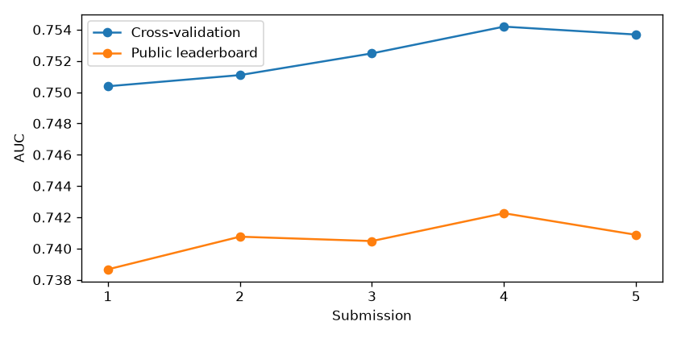

# Run report: large-scale-loan-repayment-modeling-challenge

## Result

- Best public score: **0.74226**
- Rank: **1 of 12** (top 8.3%)
- Public score needed: top 1: 0.74226, top 5: 0.74226, top 20: 0.74111
- These are public leaderboard numbers. Final standings come when the competition closes.

## Submissions

| When (UTC) | Candidate | CV | Public | CV minus public |
|---|---|---|---|---|
| 2026-11-04T03:19:42+00:00 | blend-r0 | 0.75038 | 0.73867 | 0.01171 |
| 2026-11-04T06:11:58+00:00 | blend-r4 | 0.75109 | 0.74076 | 0.01033 |
| 2026-11-04T07:24:44+00:00 | blend-r6 | 0.75248 | 0.74048 | 0.01200 |
| 2026-11-04T12:04:07+00:00 | blend-r11 | 0.75419 | 0.74226 | 0.01193 |
| 2026-11-04T17:37:55+00:00 | blend-r16 | 0.75369 | 0.74088 | 0.01281 |

## Best experiments (59 ran)

| Id | Round | Family | CV | Fold std | Seconds | Hypothesis |
|---|---|---|---|---|---|---|
| a645364365a7 | 16 | lightgbm | 0.75138 | 0.02333 | 1284.9 | A second seed of the lr-0.015 depth-11 plan (0.7510 on seed 720) tests whether its edge over the ~0.7500 lr-0.025 mean holds beyond the ~0.002 seed spread, and grows its own bag. |
| 6b4b1a0a4c15 | 15 | lightgbm | 0.75105 | 0.02320 | 2247.3 | Learning rate is the only switch whose gain has held across feature plans, so the unmeasured lr 0.015 on depth 11 (round cap about 6000) tests whether finer steps keep lifting CV above the ~0.7505 bag mean. |
| 752cee1cdf47 | 16 | lightgbm | 0.75086 | 0.02321 | 1077.1 | A third seed of the lr-0.015 depth-11 plan steadies its target-encoding splits, because the blend averages seeds per plan and more seeds of the leading plan keep paying. |
| f907554faf11 | 15 | lightgbm | 0.75072 | 0.02334 | 856.9 | A third seed of the lr-0.025 511-leaf depth-12 plan (seeds 0.7492 and 0.7499) steadies that bag's encoding before testing it as a separate blend member, with the round cap at least 4000. |
| f0ff30e36ebb | 11 | lightgbm | 0.75057 | 0.02304 | 808.5 | Deep LightGBM 1ac275ed96fd ties for best over three seeds (mean about 0.7485), so a lower learning rate of 0.025 on a fresh seed tests whether finer steps lift it beyond the ~0.003 seed spread. |
| 64924791de0c | 12 | lightgbm | 0.75038 | 0.02334 | 767.8 | A second seed of the learning-rate-0.025 depth-11 config f0ff30e36ebb (CV 0.7506) tests whether its edge over the ~0.7485 depth-11 mean holds beyond the ~0.003 seed spread, so it can be bagged as its own blend member. |
| eeb90a1ab0bc | 11 | lightgbm | 0.75036 | 0.02346 | 743.5 | Depth 11 tied or edged depth 5-7 while depth 2 lost about 0.008, so the untried largest tree size (512 leaves, depth 12), held back by min_child 4000 and L2 60, tests whether even higher-order interactions keep helping. |
| bc6dc6759352 | 15 | lightgbm | 0.75025 | 0.02358 | 2061.2 | A third drop_k=5 seed of the lr-0.025 depth-11 plan grows the leading bag and gives the drop_k=5 side of the matched pair a firmer seed mean against drop_k=0 seed 712. |
| 2bcf17067773 | 17 | lightgbm | 0.74994 | 0.02317 | 1184.1 | A fresh seed of the leading lr-0.015 depth-11 plan under drop_drifting_top_k=0, with the round cap at 8000 or more, gives the matched drop_k comparison against the ~0.7511 drop_k=5 seed mean and shows whether the 4000 cap was truncating it. |
| 67b5145e8f1f | 14 | lightgbm | 0.74988 | 0.02358 | 1857.1 | A second seed of the lr-0.025 plus 511-leaf depth-12 combination (single run 0.7492) tests whether the two separate gains really fail to add or whether the first seed was unlucky. |

## The team

| Agent | Answers | Rejected | Heuristic took over | Errors |
|---|---|---|---|---|
| analyst | 19 | 5 | 0 | 0 |
| critic | 14 | 0 | 0 | 0 |
| features | 21 | 6 | 2 | 0 |
| scout | 1 | 0 | 0 | 0 |
| tuner | 17 | 0 | 0 | 0 |
| validation | 1 | 0 | 0 | 0 |

## What the verifier stopped

- `features` (semantic): The rationale states that every feature has missing values, but the facts only give n_features=1105. This is an invented data-profile fact.; The rationale claims the drift comes from a time-like clock feature, which is not in the provided facts. This is an invented fact.; The rationale says dropping the most drifting features fails to remove the train-vs-test separation at any tested k, but no past experiments are given in the facts. This claim is unsupported.
- `analyst` (semantic): The diagnosis says 'Stronger recency weighting hurt in every comparison', but CatBoost at half-life 0.4 scored 0.7436 versus 0.7431 at half-life 1.0 (ad3903ea0ca6 vs 1a04be1d7d70). The 'every comparison' claim, and the advice to keep half-life in 1.0-1.5, are not supported by the scores given.
- `features` (semantic): Rationale says 'freq-1000 was never worse', but a26c37deddf0 (frequency encoding, XGBoost, 0.7451) scored below fc03d1de693f (frequency encoding off, 0.7471), so the claim is contradicted by the experiment record.
- `features` (semantic): The rationale says TE vs frequency encoding and drop_k 0 vs 5 differ by 'at most ~0.0013'. The experiments show TE (384ca7a98ce5, CV 0.7461) vs frequency (7810e9483dff, CV 0.7480) differs by about 0.0019, which contradicts the 'at most' bound.
- `analyst` (semantic): Diagnosis claims the lr-0.025 depth-11 seed mean is about 0.7505 and that the 511-leaf depth-12 seed mean is about 0.7483: (0.7506+0.7504)/2 is about 0.7505 (consistent), and (0.7504+0.7462)/2 is about 0.7483 (consistent), so arithmetic holds. However the diagnosis states the 511-leaf pair differs by 0.0042 which is correct (0.7504-0.7462=0.0042). Main issue: the output's lesson says the lr-0.025 combination a2daa7c44afa (0.7492) 'trailed depth 11 at lr 0.025', which is consistent with its CV 0.7492 versus 0.7505. The output's stated gap 0.011933 matches observed_gap. The 0.7464 seed for lr-0.04 depth-11 matches 1ac275ed96fd's neighbor run e469eac53dbc, but the cited lr-0.04 depth-11 trio (0.7464, 0.7494, 0.7496) is taken from lessons and the 0.7464 value is actually seed 708 CV 0.7494 and seed 709 CV 0.7496 with seed 707 at 0.7464, so the seed listing is correct as a set. The diagnosis cites 'Publicly we hold rank 1 of 12 at 0.74226, tied with the top_1 cutoff', consistent with the leaderboard. No contradiction or invented measurement found in the cited numbers, so the notes are only observations.
- `analyst` (semantic): The output's diagnosis claims the lr-0.025 depth-11 config on drop_k=0 scored 0.7494 and frames the lr-0.025 combo second seed as 0.7499, but the facts list only shows observed_gap; the cited values match experiments (1d025103a555 cv 0.74938, 67b5145e8f1f cv 0.74988), so no invented numbers there. However the diagnosis says the lr-0.025 + 511-leaf second seed 'ties' and that lr is 'the only switch with a consistent edge' while the depth-12 lr-0.04 seed-3 mean is 0.7483 vs 0.7485; these follow from the data. The lesson claiming seed means 0.7501 for lr-0.025 depth-11 uses seeds 710-712 which is consistent with experiments (0.7506, 0.7504, 0.7494 mean ~0.7501). No contradiction or invented measurement found that rises to rejection; the output's lesson to run lr 0.015 and a 6000-round cap is a plan, not a measurement.
- `analyst` (semantic): Output's lr-0.025 depth-12 511-leaf bag claim: diagnosis says three seeds 0.7492/0.7499/0.7507 with mean ~0.7499, but experiments show seeds 1401 (0.7492), 1402 (0.7499), 1403 (0.7507, the 'cv' of 1403 is not present in the list; only 1401, 1402 at lr 0.025 depth 12 appear), so the third seed is not in the payload.; Output's lr 0.015 claim of 'best single model so far' and the 0.7510 CV is consistent with the data, but the lesson about lr-0.025 depth-11 drop_k=5 3-seed bag mean ~0.7504 uses seeds 710/711/714 which match the payload (0.7506/0.7504/0.7503).; Output cites lr 0.04 to 0.025 to 0.015 steps lifting CV by about 0.0005-0.002, which is a loose inference, not a contradiction.; Output's statement that 'public rose from 0.73867 to 0.74226 as CV rose from 0.7504 to 0.7542' matches recent_submissions; cv_lb_gap_cited matches observed_gap.
- `features` (semantic): The rationale says the lr-0.025 seeds (about 0.7500 mean) all used drop_k=5, but experiments 67b5145e8f1f (seed 1402) and 1d025103a555 (seed 712) used drop_drifting_top_k=0.
- `features` (semantic): The rationale says 'the smallest measured drop is kept', but it keeps drop_drifting_top_k=5 while drop_k=0 was also measured and is smaller. This contradicts the stated reasoning.
- `analyst` (semantic): Contradiction with facts: the diagnosis says every depth-12 lr 0.015 fold stopped at 3984-4000 iterations, but the payload's best_iters for that run (cv 0.7485279) are 3688, 3984, 4000, 3996, 3731, so two folds stopped below 3984.

## Lessons the team passed forward

- Round 0: Feature Engineer: try drop_drifting_top_k > 0 (e.g. 20-50 of the most adversarially separable features, including or excluding the drift clock feature_492). All round-0 runs used drop_drifting_top_k=0 under adversarial AUC 1.0, so this is the main untested lever for closing the 0.0117 gap.
- Round 0: Model Tuner: judge candidates on the latest-period fold score rather than mean CV, since fold std (~0.024) exceeds the CV differences between models (~0.004) and the blend's +0.003 CV gain did not show up on public (0.73867 < every single-model CV).
- Round 0: Model Tuner: fold best_iters vary 2-3x (e.g. XGBoost 394-998). Fix a single iteration count per family from the late-period fold, or average, rather than trusting per-fold early stopping when refitting for test.
- Round 0: Model Tuner: recency half-life 0.5 vs none gave a near-identical CV for LightGBM (0.7441 vs 0.7436). Test a stronger setting, such as a shorter half-life or training only on the most recent portion, judged on the late fold, before investing in more model families for blend diversity.
- Round 1: Feature Engineer: run drop_drifting_top_k in the 20-50 range on the fc03d1de693f XGBoost config, unchanged otherwise, with no target encoding. All 8 runs used 0, and this is the main untested lever against the 0.0117 CV-public gap under adversarial AUC 1.0.
- Round 1: Feature Engineer: target_encode_max_cardinality=1000 showed no gain. Every round-1 run that used it scored below the best no-TE run (0.7471), though each was confounded with a recency change. Test TE alone on the fc03d1de693f config, changing nothing else, before keeping it.
- Round 1: Model Tuner: change one factor per run. In round 1, TE and half-life moved together, so neither effect is identifiable. Do not go below half-life 0.4: the only clearly worse result was LightGBM at 0.15 (0.7406). Half-lives from 0.4 to 1.5 were within noise of each other.
- Round 1: Model Tuner: submit the single best model (XGBoost fc03d1de693f, CV 0.7471) alone. Its public score, compared with the blend's 0.73867, shows whether blending helps on public at all. The blend's +0.003 CV edge did not carry to public.
- Round 3: Feature Engineer: run drop_drifting_top_k=30 (then 60), changing nothing else, on the current best config 7810e9483dff. That means LightGBM depth 5, min_child 2000, colsample 0.05, frequency encoding 1000, half-life 1.0, seed 303. All 14 runs so far used 0 under adversarial AUC 1.0, and encoding toggles only move CV by ±0.002 against a 0.0117 public gap.
- Round 3: Model Tuner: next round, submit 7810e9483dff alone (CV 0.7480). The only public evidence is the blend at 0.73867, which is below every tree model's CV. A single-model public score tells us whether CV gains since round 0 transfer at all, before more blend members are added.
- Round 3: Feature Engineer: keep frequency encoding for LightGBM but not for XGBoost. On identical configs and seeds it moved LightGBM +0.0019 (0.7461→0.7480) and XGBoost −0.0020 (0.7471→0.7451), and TE also cost XGBoost 0.0020. Use the plain row_stats plan for XGBoost fc03d1de693f.
- Round 3: Model Tuner: stop shrinking trees and drop logistic from the blend. The depth-3, 8-leaf LightGBM scored 0.7428 and logistic 0.7005, both clearly below the depth-5, min_child 2000, colsample 0.05 region. Search locally around that region instead, one factor at a time: colsample 0.03 or 0.08, min_child 1000 or 4000, keeping half-life at 1.0.
- Round 4: Model Tuner: next submissions should be 7810e9483dff (drop_drifting_top_k=0, CV 0.7480) and 315c3381dc56 (same config with drop 5, CV 0.7467), each alone. Dropping the drift features cost 0.0013 CV, and only public can show whether it buys robustness to drift. Decide on keeping drift drops from that pair.
- Round 4: Model Tuner: stop the min_child/colsample search on LightGBM depth 5. min_child 1000, 2000 and 4000 and colsample 0.03 vs 0.05 all fall within 0.0007 of each other on the same drop-5 plan. Fix min_child at 2000–4000 and colsample at 0.05.
- Round 4: Feature Engineer: do not escalate to drop_drifting_top_k 30–60 until the single-model public pair is back. The only measured step (k=5) lowered CV, so larger k is justified only if 315c3381dc56's public score is at least as high as 7810e9483dff's.
- Round 4: Model Tuner: the blend's CV edge over the best single model shrank from +0.003 (r0) to +0.0031 over 0.7480 (r4), yet public improved +0.0021. Keep the blend restricted to the tree models at 0.747 or above (7810e9483dff, fc03d1de693f, 42d369a376a6). Leave out logistic (0.7005) and depth-3 LightGBM (0.7428) unless a public test shows they help.
- Round 5: Model Tuner: treat any single-seed CV difference under 0.002 as noise. That is the seed-303 vs seed-404 spread on 7810e9483dff (0.7480 vs 0.7461), and it covers depth 7 (+0.0008), reg_lambda 10 (−0.0011) and every min_child/colsample variant. Stop one-factor sweeps on LightGBM depth 5–7.
- Round 5: Model Tuner: spend the next runs on seed-bagging instead. Run 7810e9483dff and 53b9bb941f51 with 3 seeds each, averaged as blend members, since seed averaging is the only lever left that is larger than the tuning deltas.
- Round 5: Model Tuner: submit 7810e9483dff alone before the next blend; it is still unsubmitted after two rounds of asking. Both public points (0.73867, 0.74076) are blends, so we cannot tell whether single-model CV gains or the blend itself drove the +0.0021 public gain.
- Round 5: Model Tuner: leave CatBoost 9a17f09758ae (0.7428) and lambda-10 5d3647d8fbcc (0.7469) out of the blend. Keep the blend to tree models at 0.747 or above with distinct structure: 7810e9483dff, 53b9bb941f51, fc03d1de693f, 42d369a376a6.
- Round 5: Feature Engineer: the public gap (0.0103) is about 5x every feature-plan CV delta seen (±0.002), so CV alone cannot rank drift handling. Hold drop_drifting_top_k at 0 for LightGBM, the drop-5 run cost 0.0013 CV. Revisit only if a single-model public submission of 315c3381dc56 beats 7810e9483dff.
- Round 6: Model Tuner: stop adding seed copies to the blend. Going from blend-r4 to blend-r6 added +0.0014 CV and lost 0.0003 public. Keep blend-r4's member set as the safe final candidate. Only change composition if a single-model public score justifies it.
- Round 6: Model Tuner: the next submission must be a single model, the 3-seed average of depth-5 7810e9483dff (seeds 303/404/505, CV 0.7480/0.7461/0.7486), submitted alone. Three blend submissions in a row cannot show whether the CV-to-public gap of about 0.011 comes from the blend or from the base model.
- Round 6: Model Tuner: treat XGBoost differences under 0.003 as noise. Seed 38 vs seed 37 on an identical config and plan differed by 0.0027 (0.7478 vs 0.7451), so the earlier read that frequency encoding hurt XGBoost (0.7451 vs 0.7471) is not supported.
- Round 6: Feature Engineer: no CV-measured feature change (TE vs frequency, drop_k 0 vs 5) exceeds the 0.0025 seed spread, while the gap is about 0.011. Pair the single-model submission above with 315c3381dc56 (drop_drifting_top_k=5) as a seed-averaged single. Decide drift dropping from the public difference, not from CV.
- Round 8: Model Tuner: keep blend-r4 (public 0.74076) as the final safe candidate. blend-r6 beat it on CV by +0.0014 but lost 0.0003 public. Any new blend must beat blend-r4 on public before replacing it; higher blend CV alone is not grounds to switch.
- Round 8: Model Tuner: next submission is the 3-seed average of depth-7 53b9bb941f51 (seeds 303/404/505, mean ≈0.7483 CV), submitted alone. Submit the 3-seed depth-5 7810e9483dff average alone in the same round if slots allow. These are the only way to tell whether the ~0.011 gap comes from the base model or from blending.
- Round 8: Model Tuner: treat depth-5 vs depth-7 as a tie (seed-mean difference ≈0.0007 against ~0.002 seed spread). Keep both bags as separate blend members rather than choosing one on CV.
- Round 8: Model Tuner: run 2 more seeds each of deep LightGBM 1ac275ed96fd (0.7464) and shallow XGBoost c552ea9d43d9 (0.7455). Run them in parallel with the single-model work, not instead of it. Each is one seed and lies within ~0.003 of the best, so neither is ruled out. c552ea9d43d9's std of 0.0199 is the only clear between-period stability signal so far, which makes it the candidate to test as a blend member on public.
- Round 8: Feature Engineer: no feature-plan change has moved CV beyond the ~0.0025 seed spread, while the public gap is ~0.012. Pick drift handling from public, not CV: submit a seed-averaged single of the drop_drifting_top_k=5 plan (315c3381dc56 config) next to the drop_k=0 single above.
- Round 9: Model Tuner: treat depth-11 LightGBM 1ac275ed96fd as a tie with the depth-5 and depth-7 bags, not as the new best. Its seeds differed by 0.0030 (0.7464 vs 0.7494), so the 0.7494 single run is seed luck until a third seed confirms it. Run a third seed in parallel with the other work and keep it as a separate seed-averaged blend member.
- Round 9: Model Tuner: the low between-period std of shallow XGBoost c552ea9d43d9 is reproducible: 0.0199 and 0.0201 across seeds 909/910, against 0.023-0.025 for every other config. Build one candidate blend as blend-r4's members plus the 2-seed c552ea9d43d9 average and test it on public. That is the direct check of whether period-stability, rather than higher CV, closes the 0.012 gap.
- Round 9: Model Tuner: the gap has stayed at 0.0103-0.0120 over three blend submissions, and the higher-CV blend-r6 lost 0.0003 public to blend-r4. Submit at least one seed-averaged single model next, for example the 3-seed depth-7 53b9bb941f51 bag. Keep blend-r4 (0.74076) as the fallback; a new blend needs to beat it on public, not on CV.
- Round 9: Feature Engineer: drift handling is still unresolved by CV, since drop_drifting_top_k=5 vs 0 moved CV by only about 0.0013, below the ~0.003 seed spread. Pair the single-model submission with a seed-averaged single on the drop_drifting_top_k=5 plan (315c3381dc56 config) and decide from the public difference.
- Round 10: Model Tuner: rate deep LightGBM 1ac275ed96fd a tie, not a new best. Its seeds score 0.7464, 0.7494 and 0.7496, a mean of about 0.7485 against about 0.7483 for the depth-7 53b9bb941f51 bag. Keep its 3-seed average as its own blend member. Seed 709 changed drop_drifting_top_k to 5, so it is not a pure seed replicate; do not cite it as one.
- Round 10: Model Tuner: build blend-r4's members plus the 3-seed c552ea9d43d9 XGBoost average (seeds 909/910/911, between-period std 0.0198-0.0201 against 0.023-0.025 elsewhere) and submit it for public. This tests whether period-stability rather than CV narrows the 0.012 gap. Replace blend-r4 (0.74076) only if this blend beats it on public.
- Round 10: Model Tuner: three blend submissions in a row have produced no single-model public score. In the next round, submit the 3-seed depth-7 53b9bb941f51 bag alone, and the 3-seed deep 1ac275ed96fd bag alone if slots allow. This separates base-model gap from blending gap.
- Round 10: Feature Engineer: drop_drifting_top_k=5 vs 0 is again a null result on CV in two families. Deep LightGBM seed 709 vs 708 differs by +0.0002, and XGBoost seed 911 vs 910 by +0.0001, both far below the ~0.003 seed spread. Stop proposing drift-drop variants judged on CV. Decide drop_k from a paired public submission of seed-averaged singles on each plan.
- Round 10: Model Tuner: the lead to close is 0.00035 public (0.74076 vs top_1 0.74111). Keep blend-r4 as the final fallback. Rank candidate blends by their public difference from 0.74076, because blend-r6's +0.0014 CV gain turned into a -0.0003 public loss.
- Round 11: Model Tuner: rerun the learning rate 0.025 depth-11 config (f0ff30e36ebb, CV 0.7506) and the 511-leaf depth-12 config (eeb90a1ab0bc, CV 0.7504) on new seeds in the same round. Their ~0.002 edge over the depth-11 mean of ~0.7485 is below the ~0.003 seed spread. Bag each as its own blend member only if the seed means hold above 0.749.
- Round 11: Model Tuner: add one run combining learning rate 0.025 with the depth-12, 511-leaf, min_child 4000, L2 60 settings, which has never been measured. Lower learning rate and larger trees each edged the baseline separately. Its best_iters may exceed 3000, so do not cap rounds below about 4000.
- Round 11: Model Tuner: candidate blends can now be ranked by CV. Blend CV and public moved together across r6 to r11 (+0.0017 CV, +0.0018 public), and the gap held at 0.0103-0.0120. Submit only a blend whose CV exceeds 0.75419. Build it as blend-r11 plus the round-11 deep LightGBM seed bags, and keep blend-r11 (0.74226) as the fallback.
- Round 11: Feature Engineer and Model Tuner: drop the planned single-model public submissions. No single model is above the submitted CV of 0.75419 (best is 0.7506), so none can be submitted. Test drop_drifting_top_k=5 vs 0 instead as two blends with otherwise identical members, each above 0.75419 CV, and compare them on public.
- Round 12: Model Tuner: bag the lr-0.025 depth-11 config (seeds 710 and 711, CV 0.7506 and 0.7504, mean about 0.7505) as its own blend member. Add it to blend-r11's members and submit only if the new blend's CV exceeds 0.75419. Keep blend-r11 (public 0.74226) as the fallback.
- Round 12: Model Tuner: rate the 511-leaf depth-12 config a tie, not a gain. Its seeds span 0.7462-0.7504 (mean about 0.7483), matching the lr-0.04 depth-11 mean of about 0.7485. Include its 2-seed average in a blend only if it raises blend CV, and run a third seed (e.g. 1303) in the same round to steady the bag.
- Round 12: Model Tuner: the lr-0.025 + 511-leaf depth-12 combination (a2daa7c44afa, CV 0.7492) has one seed only. Run a second seed alongside the next blend members before judging whether the two gains fail to add. Keep the boosting-round cap at or above about 4000, since its best_iters reached 3556.
- Round 12: Model Tuner: to isolate the learning-rate effect, run lr 0.025 depth 11 with drop_drifting_top_k=0 on a new seed. Both lr-0.025 runs used drop_k=5 and inner_folds=5, while the lr-0.04 seeds 707 and 708 used drop_k=0.
- Round 12: Feature Engineer: decide drop_drifting_top_k by two blends with otherwise identical members, one on the drop_k=5 plan and one on drop_k=0. Submit them only if both exceed 0.75419 CV, and compare them on public.
- Round 14: Model Tuner: build the next blend as blend-r11's members plus the lr-0.025 depth-11 3-seed bag (710/711/712, mean ~0.7501) as its own member. Submit it only if its CV exceeds 0.75419, and keep blend-r11 (public 0.74226) as the fallback.
- Round 14: Model Tuner: in the same blend round, test the lr-0.025 depth-12 511-leaf 2-seed bag (a2daa7c44afa + 67b5145e8f1f, mean ~0.7495) and the lr-0.04 depth-12 3-seed bag (mean ~0.7483) as separate added members. Keep each only if it raises blend CV, since both tie the depth-11 bags as single models.
- Round 14: Model Tuner: keep the boosting-round cap at or above about 4000 for every lr-0.025 run. Best_iters reached 3258 on the drop_k=0 depth-12 seed and 3556 on the drop_k=5 one.
- Round 14: Feature Engineer and Model Tuner: settle drop_drifting_top_k with a matched pair at lr 0.025 depth 11. Run a drop_k=0 seed (e.g. 713) and a drop_k=5 seed (e.g. 714) in the same round, so each setting has at least two seeds. The current ~+0.001 edge for drop_k=5 rests on single-seed comparisons below the ~0.003 seed spread.
- Round 14: Model Tuner: the learning rate is the only switch whose direction has held across feature plans (+0.0015 on drop_k=0, about +0.002 on drop_k=5). Learning rates below 0.025 have never been measured, so add one depth-11 run at lr 0.015 with the round cap raised to about 6000 alongside the other members.
- Round 15: Model Tuner: rerun lr 0.015, depth 11, 255 leaves (6b4b1a0a4c15 params) with the boosting-round cap explicitly at 8000 or more. Seed 720 stopped at 3999 and 3996 on two folds, which looks like a 4000 cap was binding, so the 0.7510 CV may be understated.
- Round 15: Model Tuner: grow lr 0.015 depth 11 into a seed bag with two new seeds (e.g. 721, 722) in the same round. Then add the bag as its own blend member alongside blend-r11's members and submit only if the blend CV exceeds 0.75419, keeping blend-r11 (public 0.74226) as the fallback.
- Round 15: Model Tuner: lr 0.01 has never been measured. Since CV rose stepwise from lr 0.04 (seed means about 0.7485) to 0.025 (about 0.7504 on drop_k=5) to 0.015 (0.7510), add one depth-11 run at lr 0.01 with a round cap of about 12000 in the same round as the lr-0.015 bag.
- Round 15: Model Tuner: add the lr-0.025 depth-11 drop_k=5 3-seed bag (710/711/714, mean about 0.7504) to the next blend as a separate member from any lr-0.015 bag. Keep it only if it raises blend CV above 0.75419.
- Round 15: Feature Engineer and Model Tuner: drop_k=0 at lr 0.025 depth 11 has only one seed (712, 0.7494) against three drop_k=5 seeds (mean about 0.7504). Run one more drop_k=0 seed there (e.g. 713) in the same round to firm the roughly +0.001 edge before settling drop_drifting_top_k=5 for all future plans.
- Round 16 (operator): The blend method changed at round 14 (decision 0009). Seeds of a plan are averaged before plans are weighed. Earlier blends could pick a lucky seed, and that luck carries into their cross-fit rows, so their CV reads high: blend-r11 at 0.75419 cannot be compared with blend-r15 at 0.75364. best_submitted_cv now counts only blends made the current way. No blend of the current method has a public reading yet, and blend-r11 holds rank 1 of 12 at 0.74226 public.
- Round 16 (operator): Measured so far on deep LightGBM: learning rate 0.015 at depth 11 scored 0.75105 on seed 720, the best single model yet, while learning rate 0.025 averages about 0.7500 over its seeds, which spread by up to 0.002. Seed copies of depth 12 with 511 leaves range from 0.7482 to 0.7507. Comparing drop_drifting_top_k 0 and 5 on CV stays inconclusive.
- Round 16: Model Tuner: the effective round cap for lr 0.015 is 4000. Seeds 720, 721 and 722 at depth 11 each had folds stop at 3987-3999. Rerun the lr-0.015 depth-11 plan with the cap verified at 8000 or more, same features and a fresh seed, to measure whether the cap was truncating it.
- Round 16: Model Tuner: lr 0.015 at depth 11 beat lr 0.025 on all three seeds (mean about 0.7511 vs 0.7504). The learning-rate trend is still rising, so an lr 0.01 depth-11 run with a cap of at least 10000 is the next unmeasured step.
- Round 16: Model Tuner: rerun lr 0.015 on the 511-leaf depth-12 plan with a raised cap and a second seed before judging it. Its only run (0.74853) had folds stopping at 3984, 4000 and 3996, so truncation is not ruled out.
- Round 16: Feature Engineer: drop_drifting_top_k 0 vs 5 is still unresolved. Add a drop_k=0 seed of the lr-0.015 depth-11 plan as one slot of a four-model round, to get a matched comparison on the leading plan.

## Run

- Leak canary (shuffled labels): 11 of 11 feature plans passed.
- LLM spend: $3.83 of $6.00.
- Last stop reason: `no_gain`.
