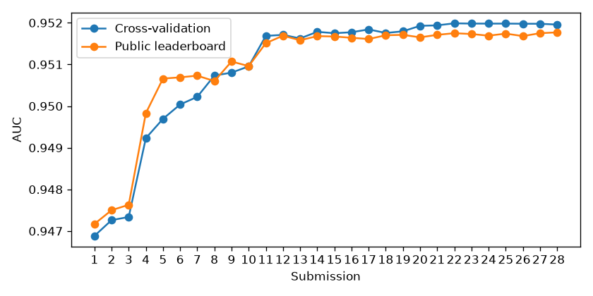

# Run report: playground-series-s6e11

## Result

- Best public score: **0.95177**
- Rank of this score: **176 of 841** (top 20.9%), read at 2026-11-06T00:35:59+00:00
- Public score needed: top 20%: 0.95188, top 10%: 0.95235, top 5%: 0.95239
- Kaggle's board shows a higher score for this team, which uses other people's predictions. It has its own ledger and is left out here.
- These are public leaderboard numbers. Final standings come when the competition closes.

## Submissions

| When (UTC) | Candidate | CV | Public | CV minus public |
|---|---|---|---|---|
| 2026-11-04T03:24:47+00:00 | blend-r0 | 0.94688 | 0.94717 | -0.00029 |
| 2026-11-04T03:28:39+00:00 | blend-r1 | 0.94726 | 0.94750 | -0.00024 |
| 2026-11-04T03:34:09+00:00 | blend-r2 | 0.94734 | 0.94763 | -0.00029 |
| 2026-11-04T04:08:06+00:00 | blend-r4 | 0.94923 | 0.94983 | -0.00060 |
| 2026-11-04T04:34:37+00:00 | blend-r6 | 0.94969 | 0.95066 | -0.00097 |
| 2026-11-04T05:16:10+00:00 | blend-r13 | 0.95004 | 0.95069 | -0.00065 |
| 2026-11-04T06:35:54+00:00 | blend-r17 | 0.95022 | 0.95073 | -0.00051 |
| 2026-11-04T07:56:26+00:00 | blend-r20 | 0.95073 | 0.95060 | 0.00013 |
| 2026-11-04T10:14:21+00:00 | blend-r29 | 0.95080 | 0.95107 | -0.00027 |
| 2026-11-04T10:31:14+00:00 | blend-r30 | 0.95095 | 0.95096 | -0.00001 |
| 2026-11-05T00:24:34+00:00 | blend-r57 | 0.95168 | 0.95151 | 0.00017 |
| 2026-11-05T00:28:12+00:00 | operator-boosters_trees | 0.95171 | 0.95169 | 0.00002 |
| 2026-11-05T00:28:37+00:00 | operator-wide | 0.95162 | 0.95158 | 0.00004 |
| 2026-11-05T00:30:37+00:00 | operator-top_lgb | 0.95178 | 0.95168 | 0.00010 |
| 2026-11-05T00:31:14+00:00 | operator-more_top | 0.95175 | 0.95167 | 0.00008 |
| 2026-11-05T02:04:57+00:00 | blend-r62 | 0.95177 | 0.95164 | 0.00013 |
| 2026-11-05T02:28:20+00:00 | blend-r63 | 0.95184 | 0.95161 | 0.00023 |
| 2026-11-05T02:29:59+00:00 | operator-same_recipe_new_trees | 0.95176 | 0.95170 | 0.00006 |
| 2026-11-05T06:49:03+00:00 | operator-no_tokens | 0.95179 | 0.95171 | 0.00009 |
| 2026-11-06T00:01:20+00:00 | blend-r92 | 0.95193 | 0.95165 | 0.00028 |
| 2026-11-06T00:02:01+00:00 | operator-blend-r92-stack30 | 0.95194 | 0.95171 | 0.00023 |
| 2026-11-06T00:31:49+00:00 | operator-r92-st50-lgb10 | 0.95199 | 0.95175 | 0.00024 |
| 2026-11-06T00:32:23+00:00 | operator-r92-st50 | 0.95198 | 0.95173 | 0.00025 |
| 2026-11-06T00:32:47+00:00 | operator-r92-st30-xgb10 | 0.95198 | 0.95169 | 0.00029 |
| 2026-11-06T00:33:22+00:00 | operator-r92-st60 | 0.95198 | 0.95174 | 0.00024 |
| 2026-11-06T00:34:11+00:00 | operator-r92-lgb10 | 0.95198 | 0.95168 | 0.00030 |
| 2026-11-06T00:34:47+00:00 | operator-r92-st70 | 0.95198 | 0.95175 | 0.00023 |
| 2026-11-06T00:35:49+00:00 | operator-stack-only | 0.95196 | 0.95177 | 0.00019 |

## Best experiments (354 ran)

| Id | Round | Family | CV | Fold std | Seconds | Hypothesis |
|---|---|---|---|---|---|---|
| 8328f94659be | 92 | logistic_boost | 0.95163 | 0.00292 | 381.0 | A fresh seed 331 of the leading depth-4 lr 0.03 plan under the tightened logistic start adds a new member to its bag, using a seed no earlier run has used so it cannot repeat one. |
| 6df2d2c976a7 | 87 | logistic_boost | 0.95162 | 0.00287 | 444.1 | Seed 321 of the same top plan under the tightened logistic start adds a fourth bag member, and its pair against the old-start seed-321 run (0.951592) gives one more reading of the tighter start at lr 0.03. |
| e4de759b431f | 86 | logistic_boost | 0.95161 | 0.00300 | 414.0 | Seed 325 of the same top plan under the tightened logistic start extends the bag with fresh inner encoding splits, steadying the blend average. |
| dfd2fc07063f | 90 | logistic_boost | 0.95160 | 0.00290 | 522.3 | Seed 327 of the depth-3 8-leaf residual plan gives another reading to judge its 1.1e-5 gap to depth 4 beyond seed noise. |
| c1007ef32e04 | 92 | logistic_boost | 0.95160 | 0.00302 | 594.5 | Fresh seed 333 of the depth-3 8-leaf residual plan grows its bag toward a blend member that ranks slightly differently from depth 4 at nearly the same score. |
| 280b82ae37f6 | 92 | logistic_boost | 0.95159 | 0.00290 | 378.0 | Fresh seed 335 of the regularized depth-6 residual plan, which scored 0.951586 on seed 324, adds a bag member, so this deeper and more diverse view can earn blend weight as an averaged member. |
| 3ee7552801b1 | 55 | logistic_boost | 0.95159 | 0.00289 | 384.9 | Depth-4 seed 321 on joint_by_value with joint_keys 10, paired against 0.95156, is the second seed needed to judge whether two extra value-keyed joint pairs add anything beyond seed noise. |
| f202e3022003 | 76 | logistic_boost | 0.95159 | 0.00289 | 338.4 | The top depth-4 lr 0.03 plan at seed 321 on number_tokens true with smoothing 20, paired against 0.951592, isolates how much of the round-75 drop of 0.00019 comes from smoothing 20 alone. |
| 5ebce54f5d16 | 83 | logistic_boost | 0.95159 | 0.00289 | 660.9 | Seed 321 of the same depth-4 lr 0.03 plan on joint_keys 12, paired against 0.951592, is the second seed needed to judge the joint_keys 12 switch beyond seed noise. |
| e0bfbd7b5e7e | 88 | logistic_boost | 0.95159 | 0.00298 | 381.8 | A third seed (324) of the depth-6 regularized plan, which the lessons ask for, builds a small bag so its blend contribution can be judged on averaged predictions rather than one reading. |

## The team

| Agent | Answers | Rejected | Heuristic took over | Errors |
|---|---|---|---|---|
| analyst | 104 | 19 | 4 | 0 |
| critic | 97 | 10 | 2 | 0 |
| features | 109 | 13 | 3 | 0 |
| scout | 1 | 0 | 0 | 0 |
| tuner | 133 | 42 | 7 | 0 |
| validation | 1 | 0 | 0 | 0 |

## What the verifier stopped

- `tuner` (deterministic): no_repeated_experiment: def1240899d2 already ran; no_repeated_experiment: af0098b49298 already ran; no_repeated_experiment: d14ba9c1ee32 already ran
- `critic` (semantic): The output reason says blend-r94's CV 0.951923 is about 8e-6 above best_submitted_cv 0.951840. The payload gives blend-r94 cv 0.9519234862 and best_submitted_cv 0.9518404138, a difference of about 8.3e-5, not 8e-6. The reason's gap figure contradicts agent_input, and the claim that it is below min_gain 2e-5 is therefore wrong. The hold action may still be justified by quota_left 0.
- `tuner` (deterministic): no_repeated_experiment: def1240899d2 already ran; no_repeated_experiment: af0098b49298 already ran
- `tuner` (deterministic): no_repeated_experiment: ced5e6ba6810 already ran
- `tuner` (deterministic): no_repeated_experiment: ced5e6ba6810 already ran
- `tuner` (deterministic): no_repeated_experiment: 1c9866c56eff already ran
- `tuner` (deterministic): no_repeated_experiment: ced5e6ba6810 already ran
- `tuner` (deterministic): no_repeated_experiment: 1c9866c56eff already ran
- `tuner` (deterministic): no_repeated_experiment: ced5e6ba6810 already ran
- `tuner` (deterministic): no_repeated_experiment: 1c9866c56eff already ran; no_repeated_experiment: fd4589e87ec0 already ran

## Lessons the team passed forward

- Round 0: CV tracks public within 0.0003, which is far below the 0.0032 fold std. Select candidates by CV directly and do not spend submissions probing the LB.
- Round 0: Feature Engineer: every round-0 run had target_encode_max_cardinality=0 and row_stats=false. Next round, turn on out-of-fold target encoding for the categoricals (e.g. max_cardinality 1000) and row_stats, each as a separate ablation on the LightGBM baseline (lr 0.05, 63 leaves, min_child 200). That way each change's CV delta against 0.94629 is attributable.
- Round 0: Model Tuner: do not scale capacity further. 255 leaves/depth 10/min_child 500 scored 0.94600, versus 0.94629 for 63 leaves/depth 7. Keep the cheap baseline configs fixed while features change, and only retune once a feature change moves CV by more than about 0.001.
- Round 0: Blending four same-feature models gained only about 0.0005 over CatBoost alone (0.94634 to 0.94688). Blend diversity has to come from differing feature sets, e.g. a target-encoded model blended with the frequency-encoded CatBoost, not from swapping GBDT families on identical inputs.
- Round 1: Feature Engineer: row_stats is the only untested feature switch. Run it as a single ablation on the target-encoded LightGBM (lr 0.05, 63 leaves, depth 7, min_child 200, seed 0) and attribute its delta against 0.94644. Keep target_encode_max_cardinality=1000 on, since it was non-negative for all three families.
- Round 1: Model Tuner: XGBoost is the only model whose feature change crossed the 0.001 retune threshold (+0.00136 from target encoding). Retune XGBoost on the target-encoded set, e.g. depth 6-7, lr 0.03, and reg_lambda below 10. Leave LightGBM (+0.00014) and CatBoost (+0.00045) configs fixed.
- Round 1: The remaining gap to the top-20 cutoff is about 0.004, roughly 10x the +0.00038 blend gain from round 1. Prioritize feature changes that each move single-model CV by more than about 0.001 over adding more GBDT variants to the blend.
- Round 1: Keep selecting submissions by CV alone. Two submissions have shown public-minus-CV gaps of +0.00024 to +0.00029, and a +0.00038 CV gain transferred as +0.00033 on public.
- Round 2: Feature Engineer: row_stats is neutral (LightGBM -0.00016, CatBoost +0.00015), so stop treating it as a lever. The only untested switches are drop_drifting_top_k (always 0) and recency_half_life (always null). Ablate drop_drifting_top_k (e.g. 5) on the target-encoded LightGBM (lr 0.05, 63 leaves, depth 7, min_child 200, seed 0, row_stats off), and attribute its delta against 0.94644.
- Round 2: Model Tuner: revert XGBoost to depth 5, lr 0.05, lambda 10, min_child 50, colsample 0.6 on target-encoded features (0.94658). Both retunes lost: depth 6 scored 0.94653 and depth 7 scored 0.94590. Do not retune any family again until a feature change moves single-model CV by more than 0.001.
- Round 2: Blend gains are now about +0.0001 per round (r1 to r2: +0.00008 CV, +0.00013 public), against a 0.0039 gap to top-20. Do not spend a round adding row_stats variants or more GBDT members to the blend. Only resubmit when a new feature set lifts the best single model above about 0.9475 CV.
- Round 2: Keep selecting by CV alone. Three submissions show a stable CV-minus-public gap of -0.00024 to -0.00029, and the r1-to-r2 CV gain of +0.00008 transferred as +0.00013 on public.
- Round 3: Model Tuner: lower lr with a smaller min_child helped all three families in round 3: CatBoost lr 0.05/min_child 20/lambda 5 scored 0.94712, XGBoost lr 0.03/depth 5/min_child 20/colsample 0.8/lambda 5 scored 0.94709, and LightGBM lr 0.03/depth 8/31 leaves/min_child 50 scored 0.94675. Make these the new fixed configs, replacing the old ones. Run one seed-matched check, CatBoost at lr 0.03/min_child 10, and stop retuning if it gains less than 0.0003.
- Round 3: Model Tuner: CatBoost best_iters reached 1360 and 1613 at lr 0.05. Confirm the iteration cap is at least 3000 before any lower-lr run, otherwise the folds are truncated.
- Round 3: Feature Engineer: drop_drifting_top_k (always 0) and recency_half_life (always null) are the only untested levers. Ablate drop_drifting_top_k=5, then recency_half_life, each on its own, on the new LightGBM config (lr 0.03, depth 8, 31 leaves, min_child 50, seed 31, TE on, row_stats off) and attribute the delta against 0.94675.
- Round 3: Submission: blend the three round-3 models (CatBoost 0.94712, XGBoost 0.94709, LightGBM 0.94675) and submit only if the blend CV exceeds 0.94734. Expect public of about CV + 0.00027, given the stable observed gap of -0.00024 to -0.00029. Keep selecting by CV alone.
- Round 4: Model Tuner: stop CatBoost retuning. lr 0.03 with min_child 10 gained only +0.00011 over lr 0.05 with min_child 20 (0.94886 vs 0.94875), below the 0.0003 bar, and it cost 664s vs 384s. Keep CatBoost lr 0.05 / depth 6 / min_child 20 / lambda 5 on digit_keys as the fixed config.
- Round 4: Feature Engineer: digit_keys gave +0.0016 to +0.0018 single-model CV in every family, about 5x the blend gain of +0.00037. The next round should go to further feature work, not tuning. The untested switches drop_drifting_top_k (always 0) and recency_half_life (always null) remain open. Ablate drop_drifting_top_k=5 alone on LightGBM (lr 0.03, depth 8, 31 leaves, min_child 50, seed 31, digit_keys on, TE on, row_stats off) and attribute the delta against 0.94855.
- Round 4: Feature Engineer: target_encode_bags is now exposed but has only been run at 1. With digit_keys adding new high-cardinality keys, test target_encode_bags=5 alone on the same seed-31 LightGBM digit_keys config, against 0.94855. Keep it only if it gains more than 0.0005.
- Round 4: Keep selecting by CV alone. Public beat CV in all four submissions (gap -0.00024 to -0.00060), and the r2-to-r4 CV gain of +0.00189 became +0.00220 on public. Resubmit only when a new feature lifts the best single model above about 0.9495 CV, enough to bring blend CV near 0.9500 and public near 0.9506 at the current gap.
- Round 5: Feature Engineer: target_encode_bags=5 is rejected. It lost 0.00035 on LightGBM and 0.00023 on XGBoost, seed-matched on digit_keys, while costing about 2x the time. Fix target_encode_bags=1 and do not revisit bagging.
- Round 5: Feature Engineer: the next round must run the still-untested drop_drifting_top_k=5 ablation alone, then recency_half_life alone. Use the seed-31 LightGBM digit_keys config (lr 0.03, depth 8, 31 leaves, min_child 50, TE on, bags 1, row_stats off) and attribute each delta against 0.94855. Keep a switch only if it gains at least 0.0003.
- Round 5: Model Tuner: no tuning runs next round. The fixed configs are CatBoost lr 0.05/depth 6/min_child 20/lambda 5 (0.94875), XGBoost lr 0.03/depth 5/min_child 20 (0.94881) and LightGBM lr 0.03/depth 8/min_child 50 (0.94855), all on digit_keys with bags 1. Retrain them only to carry over a feature switch that passes the ablation.
- Round 5: Submission: keep selecting by CV alone. Public beat CV in all four submissions (gap -0.00024 to -0.00060). Resubmit only when a new feature lifts the best single model above about 0.9495 CV, enough to beat blend-r4's 0.94923 by a clear margin.
- Round 6: Feature Engineer: the new fixed baseline is the seed-31 LightGBM config (lr 0.03, depth 8, 31 leaves, min_child 50) with digit_keys on, bags 1, row_stats off and target_encode_max_cardinality=700000, at CV 0.94912. All further ablations attribute their delta against 0.94912, not 0.94855.
- Round 6: Feature Engineer: high-cardinality key features (digit_keys, then exact-value TE) are the only lever whose public gain exceeded its CV gain: +0.00083 public vs +0.00046 CV at r6. Prioritise further key-construction or key-encoding variants before drop_drifting_top_k. Run drop_drifting_top_k=5 alone afterwards on the 0.94912 config, and reject it if it removes any of the encoded key columns.
- Round 6: Feature Engineer: recency_half_life is still untested (always null). Run it alone on the 0.94912 LightGBM config, and keep it only if it gains at least 0.0003 CV.
- Round 6: Model Tuner: no tuning runs. Carry the three fixed configs onto the 700000-cardinality TE setting as-is: CatBoost lr 0.05/depth 6/min_child 20 at 0.94924, XGBoost lr 0.03/depth 5/min_child 20 at 0.94936, LightGBM at 0.94912. Retrain them only to carry over a feature switch that passes its ablation.
- Round 6: Submission: keep selecting by CV alone, since the ordering held across all five submissions. Stop predicting public as CV plus a fixed offset: the gap moved from -0.00029 to -0.00097 as key features were added. Resubmit when blend CV beats 0.94969 by at least 0.0003.
- Round 8: Feature Engineer: reject frequency_encode_max_cardinality=700000. It gained only +0.00009 (0.94921 vs 0.94912) on the seed-31 LightGBM config. Keep it at 1000 and do not spend runs carrying it to CatBoost or XGBoost.
- Round 8: Feature Engineer: the next single-switch ablations on the 0.94912 LightGBM baseline (lr 0.03, depth 8, 31 leaves, min_child 50, digit_keys on, TE cardinality 700000, bags 1, freq cap 1000, seed 31) are, in order, recency_half_life alone and then drop_drifting_top_k=5 alone. Keep each only if it gains at least 0.0003. Reject drop_drifting_top_k if it removes any digit_key or TE key column.
- Round 8: Feature Engineer: given that key encodings returned roughly 2x their CV gain on public (+0.00083 public vs +0.00046 CV at r6), a key-construction variant (new digit-key combinations encoded via TE, not via frequency counts) is the preferred third experiment. A key variant gaining 0.0002 CV may be worth roughly 0.0004 public.
- Round 8: Model Tuner: no tuning runs. The fixed members on the current features are XGBoost lr 0.03/depth 5/min_child 20 (0.94936), CatBoost lr 0.05/depth 6/min_child 20 (0.94924) and LightGBM (0.94912). Retrain them only to carry a feature switch that passed its LightGBM ablation.
- Round 8: Submission: resubmit only when blend CV exceeds 0.94969 by at least 0.0003. Do not project public as CV plus a fixed offset, because the gap moved from -0.00029 to -0.00097 as key features were added.
- Round 10: Feature Engineer: permanently reject row_stats (-0.00007 at r10 on the 0.94912 LightGBM config) and TE bagging (bags=3 -0.00034 at r9; bags=5 -0.00035 on LightGBM and -0.00023 on XGBoost). Keep row_stats off, target_encode_bags=1 and frequency cap 1000. Do not carry any of these to XGBoost or CatBoost.
- Round 10: Feature Engineer: the next experiment is a new key-construction variant: new digit-key combinations encoded through exact-value TE (cardinality 700000), not through frequency counts. Run it alone on the seed-31 LightGBM baseline (lr 0.03, depth 8, 31 leaves, min_child 50, digit_keys on) and attribute its delta against 0.94912. Key features are the only lever whose public gain exceeded its CV gain (+0.00083 public vs +0.00046 CV at r6), so accept a key variant at +0.0002 CV, not 0.0003.
- Round 10: Feature Engineer: after the key variant, run recency_half_life alone, then drop_drifting_top_k=5 alone, both on the same 0.94912 config. Both are still untested. Keep each only if it gains at least 0.0003 CV, and reject drop_drifting_top_k if it removes any digit_key or TE key column.
- Round 10: Model Tuner: no tuning runs. The fixed members stay at XGBoost lr 0.03/depth 5/min_child 20 (0.94936, seed 32), CatBoost lr 0.05/depth 6/min_child 20 (0.94924, seed 33) and LightGBM (0.94912, seed 31). Retrain XGBoost and CatBoost only to carry a key or feature switch that passed its LightGBM ablation.
- Round 10: Submission: do not resubmit until blend CV exceeds 0.94969 by at least 0.0003. Select by CV alone, since the ordering held across all five submissions. Do not forecast public as CV plus a fixed offset: the gap moved from -0.00029 to -0.00097 as key features were added and is likely to widen further if more key features land.
- Round 13: Feature Engineer: switch the ablation baseline to the depth-2 LightGBM config (lr 0.1, 4 leaves, min_child 50, reg_lambda 5, seed 52, digit_keys on, TE cardinality 700000, bags 1, freq cap 1000; CV 0.94991; 113 s). Run the pending key-construction variant (new digit-key combinations through exact-value TE) on it, and run it on the depth-8 0.94912 config in the same round. Accept at +0.0002 CV on either, since key features are the only lever whose public gain exceeded its CV gain.
- Round 13: Model Tuner: shallow trees are a measured win on the current features. LightGBM depth 2 scored 0.94991 vs 0.94912 at depth 8, CatBoost depth 4 scored 0.94937 vs 0.94924 at depth 6, and 255 leaves lost 0.00128. Still unmeasured on digit_keys + TE-700000 features: XGBoost depth 2–3 (depth 3 was only run without digit_keys, at 0.94711), CatBoost depth 2–3, and LightGBM depth 3 with 8 leaves. Run these as one round of up to four members.
- Round 13: Submission: do not resubmit for blend gains that come only from new tree shapes or diversity members. r13 added +0.00034 CV for only +0.00003 public. Resubmit when a feature or key switch has passed its ablation and blend CV exceeds 0.95004, or when blend CV exceeds 0.95004 by at least 0.0005 without a feature change.
- Round 13: Model Tuner: when a feature switch passes, carry it to the depth-2 LightGBM, the depth-5 XGBoost (0.94936) and the depth-4 CatBoost (0.94937) members. Keep the depth-6 CatBoost only if blend CV drops without it, because depth 4 beat it on the same features.
- Round 14: Model Tuner: update the blend roster with the measured shallow members. Swap CatBoost depth 3 (lr 0.08, colsample 0.5, reg_lambda 10, min_child 20; 0.94949) in for depth 6 (0.94924), since it beats depth 6 by +0.00025. Add XGBoost depth 2 (lr 0.1, 4 leaves, min_child 50; 0.94943) alongside depth 5 (0.94936). Keep LightGBM depth 2 (0.94991) and depth 3 (0.94967). Drop any member only if blend CV does not fall without it.
- Round 14: Model Tuner: CatBoost depth 2 is the one tree size still unmeasured on the current features. Its depth trend is 6→4→3 = 0.94924→0.94937→0.94949, so run it next to the feature ablations in the same round rather than spending a round on it. XGBoost depth below 5 gained at most +0.00007, so do not spend more slots on XGBoost depth sweeps.
- Round 14: Feature Engineer: the key-construction variant (new digit-key combinations through exact-value TE at cardinality 700000) is still unmeasured, and the tree-shape gains are exhausted. Run it on the depth-2 LightGBM config (seed 52, 0.94991, 113 s) and on the depth-8 seed-31 config (0.94912) in the same round. Accept it at +0.0002 CV on either, since key features are the only lever whose public gain exceeded its CV gain (+0.00083 public vs +0.00046 CV at r6).
- Round 14: Feature Engineer: recency_half_life and drop_drifting_top_k=5 remain untested. Run each alone on the depth-2 LightGBM baseline (0.94991). Keep each only at +0.0003 CV, and reject drop_drifting_top_k if it removes any digit_key or TE key column.
- Round 14: Submission: do not resubmit for the r14 shape-only members. r13's +0.00034 CV from tree shapes gave +0.00003 public. Resubmit only when a key or feature switch has passed its ablation and blend CV exceeds 0.95004. Do not project public as CV plus a fixed offset: the gap has ranged from -0.00024 to -0.00097.
- Round 15: Model Tuner: tree-shape tuning on the current features is fully measured and capped at 0.94991. CatBoost depth 2 scored 0.94957, LightGBM depth 4 with 12 leaves scored 0.94955, and slow colsample-0.5 depth-2 LightGBM scored 0.94981. Spend no new slots on depth, leaf or learning-rate variants of these families. Use the slots to carry passing feature switches onto LightGBM depth 2 (seed 52), CatBoost depth 2 and XGBoost depth 2.
- Round 15: Model Tuner: in the blend roster, put CatBoost depth 2 (lr 0.1, colsample 0.5, reg_lambda 10, min_child 20; 0.94957) in place of depth 3 (0.94949). Also test adding the colsample-0.5 depth-2 LightGBM (0.94981) as a decorrelated partner of the 0.94991 member. Keep a member only if blend CV falls without it.
- Round 15: Feature Engineer: the key-construction variant is still the only lever whose public gain exceeded its CV gain (r6: +0.00083 public vs +0.00046 CV). It means new digit-key combinations through exact-value TE at cardinality 700000. Run it this round on the depth-2 LightGBM (seed 52, 0.94991, 113 s) and the depth-8 seed-31 config (0.94912). Accept it at +0.0002 CV on either.
- Round 15: Feature Engineer: recency_half_life and drop_drifting_top_k=5 remain unmeasured. Run each alone on the depth-2 LightGBM baseline (0.94991) in the same round as the key variant. Keep each only at +0.0003 CV, and reject drop_drifting_top_k if it removes any digit_key or TE key column.
- Round 15: Submission: do not submit the round-15 shape/roster blend. Resubmit only when a key or feature switch has passed its ablation and blend CV exceeds 0.95004. Rank candidates by CV alone, since the CV ordering matched the public ordering across all six submissions. Do not project public from a fixed offset, because the gap has ranged from -0.00024 to -0.00097.
- Round 16: Feature Engineer: round 16 ran no feature ablation, so the key-construction variant is still unmeasured. That variant is new digit-key combinations through exact-value TE at cardinality 700000. Run it this round on depth-2 LightGBM (seed 52, 0.94991, 113 s) and on depth-8 seed-31 LightGBM (0.94912). Accept it at +0.0002 CV on either.
- Round 16: Feature Engineer: in the same round, run recency_half_life alone and drop_drifting_top_k=5 alone, each on the depth-2 LightGBM seed-52 baseline (0.94991). Keep each only at +0.0003 CV. Reject drop_drifting_top_k if it drops any digit_key or TE column.
- Round 16: Model Tuner: deeper members were measured in round 16 and both lost to their shallow siblings. XGBoost depth 6 scored 0.94908 against 0.94943 at depth 2, and CatBoost depth 7 scored 0.94904 against 0.94957 at depth 2. Fill spare slots by carrying each passing feature switch onto XGBoost depth 2 (lr 0.1, min_child 50) and CatBoost depth 2 (lr 0.1, colsample 0.5, reg_lambda 10), not onto depth-6/7 variants.
- Round 16: Model Tuner: test the round-16 deep XGBoost (0.94908) and CatBoost (0.94904) members in the blend only by ablation. Keep each only if blend CV falls without it, since neither beats any shallow roster member on single-model CV.
- Round 16: Submission: do not submit a round-16 roster blend. Resubmit only when a key or feature switch has passed its ablation and blend CV exceeds 0.95004. Rank by CV alone, and do not project public from a fixed offset, since the gap ranges from -0.00024 to -0.00097.
- Round 17: Feature Engineer: frequency_encode_max_cardinality=700000 is now measured as neutral on four shapes. The deltas were +0.00006 on LightGBM depth 2, -0.00005 on CatBoost depth 2, +0.00004 on XGBoost depth 2 and +0.00009 on LightGBM depth 8, all below +0.0003. Mark it rejected, run new ablations at frequency cardinality 1000 against the 0.94991 seed-52 depth-2 LightGBM, and spend no further slots carrying this switch.
- Round 17: Feature Engineer: rounds 16 and 17 both skipped the three unmeasured levers. This round, fill the slots with these four runs: (1) new digit-key combinations through exact-value TE at cardinality 700000 on seed-52 depth-2 LightGBM (0.94991, about 113 s); (2) the same key variant on seed-31 depth-8 LightGBM (0.94912); (3) recency_half_life alone on seed-52 depth-2; (4) drop_drifting_top_k=5 alone on seed-52 depth-2. Accept the key variant at +0.0002 CV on either shape and the other two at +0.0003. Reject drop_drifting_top_k if it removes any digit_key or TE column.
- Round 17: Model Tuner: carry a feature switch onto XGBoost depth 2 (seed 62, 0.94943) and CatBoost depth 2 (seed 71, 0.94957) only after it passes on depth-2 LightGBM. Round 17 showed that a switch neutral on LightGBM (+0.00006) stays neutral on the other two (+0.00004 and -0.00005), so pre-emptive carries waste slots.
- Round 17: Submission: blend-r17 gained +0.00018 CV over blend-r13 but only +0.00004 public, so roster and shape reshuffles are not closing the 0.00077 gap to top-20 (0.9515). Do not resubmit a blend that differs only in roster or tree shape. Resubmit only when a key or feature switch has passed its ablation and blend CV exceeds 0.95022. Rank by CV alone, because the ordering held across all seven submissions, and do not project public from a fixed offset (range -0.00024 to -0.00097).
- Round 18: Feature Engineer: target_encode_bags=3 has been measured only on depth-5 XGBoost with seed 182 (0.94908). That run is seed-confounded against seed-32 bags=1 (0.94936), so it is not a valid ablation. Run bags=3 alone on seed-52 depth-2 LightGBM (frequency 1000, TE 700000, baseline 0.94991, about 113 s). Keep it only at +0.0003 CV.
- Round 18: Feature Engineer: rounds 16-18 all skipped the planned levers, so fill this round's four slots with single-switch runs. (1) New digit-key combinations through exact-value TE at 700000 on seed-52 depth-2 LightGBM (0.94991). (2) The same key variant on seed-31 depth-8 LightGBM (0.94912). (3) recency_half_life alone on seed-52 depth-2. (4) drop_drifting_top_k=5 alone on seed-52 depth-2. If slots must be shared with lesson 1, run bags=3 instead of run (2). Accept the key variant at +0.0002 on either shape and the others at +0.0003. Reject drop_drifting_top_k if it removes any digit_key or TE column.
- Round 18: Model Tuner: no member at depth 5 or more beats its shallow sibling. XGBoost scored 0.94908 at depth 5 (round 18) and at depth 6 (round 16), against 0.94943 at depth 2. CatBoost depth 7 scored 0.94904 against 0.94957 at depth 2. Spend tuner slots on depth-2 shapes: carry any switch that passes on seed-52 depth-2 LightGBM to XGBoost depth 2 (seed 62, lr 0.1, min_child 50) and CatBoost depth 2 (seed 71, lr 0.1, colsample 0.5, reg_lambda 10). Do not spend them on depth-5/6/7 variants.
- Round 18: Submission: do not resubmit a blend that differs only in roster or tree shape. Blend-r13 to blend-r17 gained +0.00018 CV but only +0.00004 public. Resubmit only when a feature or key switch has passed its single-model ablation and blend CV exceeds 0.95022. Rank candidates by CV alone, since the ordering held over seven submissions. Do not project public from a fixed offset: the gap ranges from -0.00024 to -0.00097, latest -0.00051.
- Round 19: Feature Engineer: mark target_encode_bags=3 rejected. On the seed-52 depth-2 LightGBM it measured 0.94960 against 0.94991 at bags=1, a delta of -0.00031. Revert to bags=1 (frequency 1000, TE 700000) as the baseline plan, and do not carry bags=3 to the XGBoost depth-2 or CatBoost depth-2 members.
- Round 19: Feature Engineer: rounds 16-19 all skipped the three unmeasured levers, so this round's four slots must be single-switch runs on the bags=1, frequency 1000, TE 700000 plan. (1) New digit-key combinations through exact-value TE on seed-52 depth-2 LightGBM (baseline 0.94991). (2) The same key variant on seed-31 depth-8 LightGBM (baseline 0.94912). (3) recency_half_life alone on seed-52 depth-2. (4) drop_drifting_top_k=5 alone on seed-52 depth-2. Accept the key variant at +0.0002 on either shape and the others at +0.0003. Reject drop_drifting_top_k if it removes any digit_key or TE column.
- Round 19: Model Tuner: stronger regularisation on depth-2 LightGBM is measured as harmful. min_child 400, reg_lambda 30 and subsample 0.6 scored 0.94917, against 0.94960 for the default seed-52 shape on the same bags=3 plan (-0.00043). colsample 0.3 was neutral on that plan (0.94960 vs 0.94960). Do not spend tuner slots on min_child of 200 or more, reg_lambda of 30 or more, or colsample below 0.5 for depth-2 LightGBM. Keep min_child 50, reg_lambda 5 and colsample 0.8 as the carrier shape for feature ablations.
- Round 19: Submission: do not resubmit this round. No switch passed its ablation, and blend-r13 to blend-r17 gained +0.00018 CV but only +0.00004 public. Resubmit only when a feature or key switch has passed its single-model ablation and blend CV exceeds 0.95022. Rank candidates by CV alone and do not project public from a fixed offset, since the gap ranges from -0.00024 to -0.00097 and the latest is -0.00051.
- Round 20: Feature Engineer: the round-20 seed-52 depth-2 LightGBM changed two switches at once (digit_keys→number_keys and row_stats false→true), so its +0.00021 is not an ablation, and it is below the +0.0003 keep bar anyway. Next round, run row_stats=true alone on the digit_keys plan (frequency 1000, TE 700000, bags=1, baseline 0.94991). Separately, run number_keys alone with row_stats=false. Revert to the digit_keys/row_stats=false plan as baseline until one passes.
- Round 20: Model Tuner: the logistic member (0.95037) is the top single CV but was measured only on the number_keys+row_stats plan, which coincided with the public drop. Run the same logistic config on the baseline digit_keys/row_stats=false plan (one slot) so the family effect is separated from the feature-plan effect before it stays on the roster.
- Round 20: Submission: CV ordering broke. blend-r20 had CV +0.00051 over blend-r17 but public -0.00013, and the gap now ranges from +0.00013 to -0.00097. Do not resubmit a blend whose CV gain comes from members on an unablated feature plan (number_keys/row_stats) or from the logistic member alone. Resubmit only after a switch passes a clean single-switch ablation on seed-52 depth-2 LightGBM. Then submit a blend that differs from blend-r17 only by that switch's members.
- Round 20: Feature Engineer: recency_half_life, drop_drifting_top_k=5, and new digit-key combinations through exact-value TE are still unmeasured after rounds 16-20. Give them three of next round's four slots as single switches on seed-52 depth-2 LightGBM (digit_keys, row_stats=false, frequency 1000, TE 700000, bags=1, baseline 0.94991). Use the fourth slot for the row_stats-alone ablation.
- Round 22: Feature Engineer: number_keys and row_stats are now measured as single switches on seed-52 depth-2 LightGBM and both fail the +0.0003 bar. number_keys alone gave 0.95006 vs 0.94991 (+0.00015). row_stats on top gave 0.95012 vs 0.95006 (+0.00006). Do not re-run either. Keep digit_keys, row_stats=false, frequency 1000, TE 700000, bags=1 as the baseline plan (0.94991).
- Round 22: Model Tuner: logistic is still confounded. Round 21 ran it on number_keys/row_stats=false (0.95034), not on the digit_keys baseline plan. Spend one slot on the identical logistic config on digit_keys, row_stats=false, frequency 1000, TE 700000, bags=1. Keep it on the roster only if it holds near 0.9500 there.
- Round 22: Feature Engineer: rounds 16-21 have still not measured recency_half_life, drop_drifting_top_k=5, new digit-key combinations through exact-value TE, or row_stats alone on the digit_keys plan. Run these as four single-switch runs on seed-52 depth-2 LightGBM (baseline 0.94991). Accept the key variant at +0.0002 and the others at +0.0003.
- Round 22: Model Tuner: the 4-leaf depth-3 LightGBM (seed 202) scored 0.94991 against 0.95012 for the depth-2 shape on the same number_keys+row_stats plan (-0.00021). Do not spend slots on max_depth 3 with 4 leaves. Keep depth 2, min_child 50, reg_lambda 5, colsample 0.8 as the carrier.
- Round 22: Submission: do not resubmit. blend-r20 had CV +0.00051 over blend-r17 but public -0.00013 (0.95060 vs 0.95073), and the gap flipped to +0.00013. Members built on number_keys plans or the logistic family are suspected of CV-only gains. The next submission should differ from blend-r17 only by members from a switch that passed a clean ablation on the digit_keys baseline.
- Round 23: Feature Engineer: target_encode_inner_folds=3 is now measured and fails. On seed-52 depth-2 LightGBM it gave 0.95015 vs 0.95006 (+0.00009). On logistic it gave 0.95029 vs 0.95034 (-0.00005). Keep 5 inner folds and do not re-run it.
- Round 23: Feature Engineer: spend three of next round's four slots on seed-52 depth-2 LightGBM single switches against the digit_keys, row_stats=false, frequency 1000, TE 700000, bags=1 baseline (0.94991). Run recency_half_life, drop_drifting_top_k=5, and row_stats alone on digit_keys. All three are still unmeasured after rounds 16-23. Keep the +0.0003 bar.
- Round 23: Model Tuner: use the fourth slot on the identical logistic config (depth-2 params, 5 inner folds) on the digit_keys, row_stats=false baseline plan. Rounds 21 and 23 both ran it on number_keys plans, so its 0.9503 level is still confounded with the feature plan suspected of the blend-r20 public drop.
- Round 23: Model Tuner: the round-23 CatBoost (0.94972) changed number_keys and inner folds together relative to the 0.94957 digit_keys run. Do not credit either switch from it, and do not add it to the roster on that basis.
- Round 23: Submission: do not resubmit until a switch passes its clean ablation on the digit_keys baseline. Then submit a blend that differs from blend-r17 (public 0.95073) only by that switch's members. Rank candidates by CV alone, since the gap ranges from +0.00013 to -0.00097.
- Round 24: Feature Engineer: this round, spend three slots on seed-52 depth-2 LightGBM single switches against the digit_keys, row_stats=false, frequency 1000, TE 700000, bags=1, 5-inner-fold baseline (0.94991). The switches are recency_half_life, drop_drifting_top_k=5, and row_stats alone on digit_keys. All three are still unmeasured after round 23. Accept a switch only at +0.0003.
- Round 24: Model Tuner: use the fourth slot on the identical logistic config (depth-2 params, seed 201, 5 inner folds) on the digit_keys, row_stats=false baseline plan. Its three runs (0.95037, 0.95034, 0.95029) were all on number_keys plans, so its level is confounded with the plan suspected of blend-r20's public drop. Keep it on the roster only if it holds at or above 0.9500 on digit_keys.
- Round 24: Feature Engineer: these single switches are already measured on seed-52 depth-2 LightGBM and fail. frequency_encode_max_cardinality=700000 gave 0.94997 vs 0.94991 (+0.00006). target_encode_bags=3 gave 0.94960 (-0.00031). target_encode_inner_folds=3 gave +0.00009. Do not spend slots re-running them.
- Round 24: Model Tuner: these departures from the carrier (depth 2, 4 leaves, min_child 50, reg_lambda 5, lr 0.1, colsample 0.8) all scored below its 0.94991 level. Slower lr 0.05 with colsample 0.5 gave 0.94981. Depth 3 with 8 leaves gave 0.94967. Depth 4 with 12 leaves gave 0.94955. The 4-leaf depth-3 shape lost 0.00021 to the carrier on the same plan. Keep the carrier fixed while the feature switches are being ablated.
- Round 24: Submission: do not resubmit this round. After a switch passes its digit_keys ablation, submit a blend that differs from blend-r17 (public 0.95073) only by that switch's members. Then judge it by its public delta, since the CV-public gap has ranged from -0.00097 to +0.00013.
- Round 25: Feature Engineer: number_keys (+0.00015 vs the 0.94991 digit_keys carrier) and row_stats on number_keys (+0.00006, and -0.00001 on seed 203) both missed the +0.0003 bar. Revert the base plan to digit_keys, row_stats=false, frequency 1000, TE 700000, bags=1, 5 inner folds. Do not build blend members on number_keys plans.
- Round 25: Feature Engineer: use three slots for seed-52 depth-2 LightGBM single switches on that digit_keys baseline. Run recency_half_life (still unmeasured; every run has null), drop_drifting_top_k=5 (every run has 0), and row_stats=true on digit_keys. Accept a switch only at >= 0.95021.
- Round 25: Model Tuner: use the fourth slot for the identical logistic config (seed 201, depth-2 params, 5 inner folds) on the digit_keys baseline plan. Its three runs (0.95037, 0.95034, 0.95029) were all on number_keys, the plan implicated in blend-r20's public drop. Keep it on the roster only if it holds >= 0.9500 there.
- Round 25: Feature Engineer / Model Tuner: target_encode_inner_folds=3 (+0.00009 LGBM, -0.00005 logistic), target_encode_bags=3 (-0.00031), and frequency_encode_max_cardinality=700000 (+0.00006 LGBM) are measured failures, so do not rerun them. The round-23 CatBoost (0.94972) changed number_keys and inner folds together, so credit neither switch from it.
- Round 25: Submission: since blend-r20's CV gain of +0.0005 over r17 did not transfer, do not rank blends by CV alone. Submit next only a blend that differs from blend-r17 (public 0.95073) by the members of one switch that passed its digit_keys ablation, and judge it by the public delta.
- Round 26 (operator): The option digit_keys is retired: its keys were built wrong (decision 0008). number_keys replaces it, so scores and lessons that compare against digit_keys no longer apply.
- Round 26 (operator): Measured outside this run on the same folds, one seed, with number_keys and target encoding at 700000, no frequency encoding or row stats. LightGBM lr 0.05, depth 2, 4 leaves, subsample 0.8, colsample 0.5, lambda 1, min_child 100: 0.95037 with 5 inner folds, 0.95064 with 3. XGBoost lr 0.05, depth 2, subsample 0.8, colsample 0.5, lambda 1, min_child 5: 0.95024 with 2 inner folds, 0.95064 with 3, 0.95052 with 4, 0.95043 with 5. Logistic with lambda 3.3 gave 0.95018 with 5 and 0.95020 with 3. These outside scores do not have ledger ids.
- Round 26 (operator): An outside study on this competition measures about 0.0003 of noise between two close models on the public board, so blend-r20 scoring below blend-r17 is weak evidence. CV decides. Seeds of one plan differ by up to about 0.00026.
- Round 26: Model Tuner: the round-26 change (lr 0.1→0.05, colsample 0.8→0.5, lambda 5→1, min_child 50→100) gave +0.00036 on depth-2 LightGBM, and best_iters of 1000–1550 are well below any cap. Next, run depth-2 LightGBM and XGBoost at lr 0.03 and at colsample 0.3–0.4 as separate one-switch arms against 9e64ee4d3539 (0.95051) and bf64def309c3 (0.95042).
- Round 26: Model Tuner: do not spend roster slots on depth ≥4 LightGBM or XGBoost. Depth 6 LightGBM (0.94932) and depth 4 XGBoost (0.94883) both lost 0.0007–0.0012 to depth 2. Depth-2 boosting plus logistic is the measured frontier.
- Round 26: Feature Engineer: target_encode_bags has only ever been 1, and frequency_encode_max_cardinality only 1000; both are unmeasured. Inner-fold count moves scores by at most ±0.0001 with mixed sign, so try bags (e.g. 3) on the 3-fold number_keys plan with the 9e64ee4d3539 LightGBM config as a one-switch test. Logistic leans entirely on the encodings, so test bags on it too.
- Round 26: Feature Engineer: row_stats measured +0.00003 to +0.00006 on number_keys plans, below the +0.0003 bar, so do not count it as a gain source. number_keys (+0.0014) shows that key construction is where the large gains came from, so new key-based encodings are the higher-value feature direction.
- Round 26: Next blend should include the round-26 LightGBM (0.95051) and XGBoost (0.95042) members alongside logistic. Do not revert anything because blend-r20 scored 0.9506 public against blend-r17's 0.95073: that gap is within the ~0.0003 public noise, so judge the blend by CV.
- Round 27: Feature Engineer: keep target_encode_bags=1. Bags=3 measured −0.00019 on LightGBM, −0.00011 on XGBoost and −0.000004 on logistic against same-seed bags=1 runs, with no family gaining. frequency_encode_max_cardinality (only ever 1000) and new key-based encodings remain unmeasured and are the next feature arms.
- Round 27: Model Tuner: the lr 0.03 and colsample 0.3–0.4 one-switch arms on depth-2 LightGBM (vs 9e64ee4d3539, 0.95051) and XGBoost (vs bf64def309c3, 0.95042) are still unmeasured. Run them on the bags=1 plan, since best_iters of 1000–1800 leave room under the cap.
- Round 27: Model Tuner: CatBoost depths 2, 3 and 4 all sit at 0.9493–0.9497, about 0.0008 below depth-2 LightGBM. Spend a CatBoost slot only for blend diversity, and if so use depth 2 or 4 rather than depth 3 (0.94932).
- Round 27: Next blend: build it from the bags=1 round-26 LightGBM (0.95051) and XGBoost (0.95042) plus logistic 157c99517317 (0.95037), rather than the bags=3 reruns, which are 0.0001–0.0002 lower. Judge it by CV, because blend-r20's +0.00013 gap is within the ~0.0003 public noise.
- Round 28: Model Tuner: keep lr 0.05 on the depth-2 LightGBM (9e64ee4d3539) and XGBoost (bf64def309c3) carriers. lr 0.03 measured −0.00003 and −0.00006 on the same seeds while costing 2–2.3× the runtime, so it should not be a default.
- Round 28: Model Tuner: colsample 0.35 measured −0.00009 on depth-2 LightGBM, so keep 0.5 there. The XGBoost colsample 0.3–0.4 one-switch arm against bf64def309c3 (0.95042) is still unmeasured and can fill a slot. Any further depth-2 param arm should be judged against the ~0.00026 same-plan seed spread, not single-seed deltas.
- Round 28: Model Tuner: depth-3/8-leaf LightGBM (3416600a2df7, 0.95025, seed 306) is below the depth-2 leader by about seed-noise size. Rerun it on seed 301 to get a clean one-switch depth comparison. Keep it as a candidate blend member, since a different tree size may rank differently.
- Round 28: Feature Engineer: the top-20 public cutoff is ~0.001 above our 0.9506, and round-28 tuning moved scores by at most 0.0001. Put the next rounds' feature arms on the unmeasured directions: new key-based encodings (the number_keys lineage gave +0.0014) and frequency_encode_max_cardinality above 1000. Test each as a one-switch arm with the 9e64ee4d3539 LightGBM config, seed 301, on the bags=1, 3-inner-fold number_keys plan.
- Round 28: Next blend (no submission since r20): build it from the bags=1 round-26 LightGBM 9e64ee4d3539 (0.95051), XGBoost bf64def309c3 (0.95042) and logistic 157c99517317 (0.95037). Optionally add the round-28 lr-0.03 variants and the depth-3 LightGBM as extra rank-diverse members if they raise blend CV. Judge by CV, not by the r20 public reading.
- Round 30: Feature Engineer/Model Tuner: XGBoost 190d47fe517d (0.95065) changed frequency_encode_max_cardinality and row_stats together relative to bf64def309c3 (0.95042). To isolate them, run the bf64def309c3 config (seed 302, colsample 0.5) on frequency 700000 with row_stats=false. Comparing that run with 190d47fe517d gives the level-wise row_stats effect, and comparing it with bf64def309c3 gives the frequency effect.
- Round 30: Feature Engineer: row_stats measured -0.00008 on same-seed depth-2 LightGBM (seed 301), within the ~0.00026 seed spread, so it is neither confirmed nor ruled out. Frequency 700000 measured +0.00006 on the same carrier, so keep it. New key-based encodings remain the unmeasured direction. Test them as one-switch arms on the aa0c7f01ce14 config (seed 301), because the ~0.0006 gap to the top-20 exceeds every tuning delta seen so far.
- Round 30: Model Tuner: keep depth-2 as the carrier. Same-seed depth-3 LightGBM measured -0.00029 (0.95029 vs 0.95058), and leaf-wise 5 leaves/depth 4/lambda 3 measured -0.00028 (vs 0.95049). Use these only as blend members, and only if adding them raises blend CV.
- Round 30: Model Tuner: XGBoost colsample 0.35 (a7101e377462, 0.95042) ran on frequency 700000, so it is not a one-switch comparison with bf64def309c3. Judge it against the frequency-700000, colsample-0.5, row_stats=false XGBoost rerun once that rerun exists.
- Round 30: Next blend: add XGBoost 190d47fe517d (0.95065) and LightGBM a3f522e9be24 (0.95060, seed 307) as members, and judge by blend CV. Do not revert any r30 change because public dipped 0.00011 against r29 while CV rose 0.00015, which is within the ~0.0003 public noise.
- Round 31: Feature Engineer: keep frequency_encode_max_cardinality 700000. It measured +0.00016 on same-seed XGBoost and +0.00006 on same-seed LightGBM. Treat row_stats as neutral (same-seed deltas -0.00008, -0.00003, +0.00006, all inside the 0.00026 seed spread) and spend no further slots isolating it.
- Round 31: Feature Engineer: the gap to the top-20 (~0.0006) is about 4x the largest single switch measured in rounds 26-31 (+0.00016). Put feature arms on new key-based encodings, the still-unmeasured direction (the number_keys lineage gave +0.0014). Test each as a one-switch arm on both XGBoost dde344742a99 (seed 302) and LightGBM 34c1c59258ca (seed 307), so every switch gets two family readings.
- Round 31: Model Tuner: colsample 0.35 is measured negative on both depth-2 families: -0.00017 XGBoost (a7101e377462 vs dde344742a99) and -0.00009 LightGBM. Keep 0.5. Colsample above 0.5 (e.g. 0.65) is unmeasured and can fill a one-switch slot against dde344742a99 and 34c1c59258ca on the same seeds.
- Round 31: Next blend: add XGBoost dde344742a99 (0.95058), LightGBM 34c1c59258ca (0.95062) and logistic d87d637228f8 (0.95045, best logistic so far) to the r30 members 190d47fe517d and a3f522e9be24. Keep each only if it raises blend CV, since CV matched public to 0.00001 at r30.
- Round 31: Model Tuner: to judge the logistic frequency-700000 gain cleanly, rerun d87d637228f8's config on frequency 1000 with seed 312 as a one-switch arm. Its 0.95045 versus e84986806ad2's 0.95029 mixes a seed change with the plan change.
- Round 32: Model Tuner: colsample is measured flat on depth-2 carriers between 0.5 and 0.65 (+0.000004 XGBoost, -0.00005 LightGBM, same seeds) and negative at 0.35. Keep 0.5 as the carrier. Treat 9a962c1857d9 and 469369f9171f only as blend members with different feature sampling.
- Round 32: Feature Engineer: new key-based encodings remain the only unmeasured direction big enough to close the ~0.0006 gap to the top-20. Give each new encoding a one-switch arm on both XGBoost dde344742a99 (seed 302) and LightGBM 34c1c59258ca (seed 307) on the frequency-700000, row_stats=false plan, so each gets two family readings in one round.
- Round 32: Model Tuner: the logistic seed spread is measured at about 0.000004 (d87d637228f8 vs 5041ba1b589a). Its gain over the frequency-1000 logistic is therefore mostly a plan effect. Still run d87d637228f8's config on frequency 1000, seed 312, as a cheap one-switch confirmation; at about 60s it fits alongside feature arms.
- Round 32: Next blend: start from the r30 members (190d47fe517d, a3f522e9be24). Offer dde344742a99, 34c1c59258ca, 9a962c1857d9, 469369f9171f, d87d637228f8 and 5041ba1b589a as candidates. Keep each only if it raises blend CV, since CV matched public to 0.0000067 at r30.
- Round 33: Feature Engineer: rounds 32-33 ran zero feature arms, and new key-based encodings are still unmeasured. Next round, give at least two slots to one new key-based encoding as a one-switch arm, run on XGBoost dde344742a99 (seed 302) and LightGBM 34c1c59258ca (seed 307) on the frequency-700000, row_stats=false plan.
- Round 33: Use the measured seed spreads as the bar for judging switches. LightGBM is about 0.00004 (0.95058/0.95062/0.95059 over seeds 301/307/316) and XGBoost is about 0.0001 (0.95058 seed 302 vs 0.95048 seed 315). A LightGBM-carrier delta above about 0.0001 is therefore meaningful, while an XGBoost delta needs above about 0.0002 or a second seed.
- Round 33: Model Tuner: lr 0.03 measured -0.00003 on LightGBM (b8e123e1b147 vs 9e64ee4d3539) and -0.00006 on XGBoost (bf2b9298315d vs bf64def309c3), so keep lr 0.05. The ledger has no one-switch arms on reg_lambda, subsample or min_child for the depth-2 carriers. Use any free tuner slot for one of these against 34c1c59258ca on seed 307, rather than more colsample or seed replicates.
- Round 33: Next blend: start from the r30 members 190d47fe517d and a3f522e9be24. Add the new seed members c80e99433144 (LightGBM, 0.95059) and 754e2623a885 (XGBoost, 0.95048) to the candidate list along with dde344742a99, 34c1c59258ca, 9a962c1857d9, 469369f9171f, d87d637228f8 and 5041ba1b589a. Keep each only if it raises blend CV, since CV matched public to 0.0000067 at r30.
- Round 34: Feature Engineer: rounds 32-34 ran zero new key-based encoding arms, and this is the only unmeasured direction big enough to close the ~0.0006 gap to the top-20. Next round, give two slots to one new key-based encoding as a one-switch arm, on XGBoost dde344742a99 (seed 302) and LightGBM 34c1c59258ca (seed 307), both on the frequency-700000, row_stats=false, bags=1 plan.
- Round 34: Feature Engineer: target_encode_bags 3 measured -0.00019 on XGBoost (8bc44cd8c8ed vs dde344742a99, seed 302), which is right at the ~0.0002 XGBoost bar. Give it a second reading on LightGBM 34c1c59258ca (seed 307), where the bar is ~0.0001, before judging it. Keep bags=1 on carriers in the meantime.
- Round 34: Model Tuner: the ledger still has no one-switch arms on reg_lambda, subsample or min_child for the depth-2 carriers. Use free tuner slots on these against 34c1c59258ca (seed 307, frequency 700000, row_stats=false), not on colsample, lr or seed replicates, which are already measured.
- Round 34: Model Tuner: row_stats is measured flat across three same-seed pairs (+0.00007 XGBoost seed 302; -0.00002 and -0.00009 LightGBM seeds 307 and 301), all within the seed bars. Keep row_stats=false as the carrier plan for feature arms, but keep the row_stats=true members as blend candidates.
- Round 34: Next blend: start from the r30 members 190d47fe517d and a3f522e9be24. Offer c80e99433144, 754e2623a885, dde344742a99, 34c1c59258ca, 9a962c1857d9, 469369f9171f, d87d637228f8, 5041ba1b589a and 8bc44cd8c8ed (different encoding bags) as candidates. Keep each only if it raises blend CV, since CV matched public to 0.0000067 at r30.
- Round 35: Feature Engineer: no new key-based encoding has been measured in rounds 32-34; round 34 ran only bags=3. Next round, run one new key-based encoding as a one-switch arm on two carriers: XGBoost dde344742a99 (seed 302, 0.95058) and LightGBM 34c1c59258ca (seed 307, 0.95062). Use the frequency-700000, row_stats=false, bags=1 plan for both. Judge the LightGBM delta against the ~0.0001 bar and the XGBoost delta against ~0.0002.
- Round 35: Fill all four slots each round; round 34 used one. Suggested split: two slots for the key-encoding arms above, one for target_encode_bags=3 on LightGBM 34c1c59258ca (seed 307), and one tuner arm. The bags=3 run is the second reading the -0.00019 XGBoost result needs before bags is judged.
- Round 35: Model Tuner: reg_lambda, subsample and min_child have no one-switch arms on the depth-2 carriers. Use the tuner slot on one of them against 34c1c59258ca (seed 307, frequency 700000, row_stats=false). One option is min_child 100→20; the two families currently differ in min_child (5 vs 100) and this has never been isolated. Do not spend the slot on colsample, lr or seed replicates, which are already measured.
- Round 35: Blend: start from the r30 members 190d47fe517d and a3f522e9be24, then greedily offer c80e99433144, 754e2623a885, dde344742a99, 34c1c59258ca, 9a962c1857d9, 469369f9171f, d87d637228f8, 5041ba1b589a and 8bc44cd8c8ed. Keep a member only if it raises blend CV; CV matched public to 0.0000067 at r30. Submit a new blend only once a key-encoding member exists, since the remaining candidates are seed and colsample variants of members already in the blend.
- Round 36 (operator): Three things changed outside the run (decision 0009). The blend now averages the seeds of each plan before weighing plans, so more seeds of a strong plan keep paying after its single score stops rising. Plans bagged this way reached 0.95105 on CV from the same models.
- Round 36 (operator): New family glm_boost, measured outside the run on target_encode_max_cardinality 700000, inner folds 3, number_keys, frequency 700000, learning rate 0.03, depth 2, subsample 0.8, colsample 0.5, lambda 1, min_child 5: 0.95066 alone, the best single model so far, weight 0.2 in the blend, and blend CV +0.00009. Its seeds have not been measured.
- Round 36 (operator): New experiments predict test with the fold models and a refit on every row together, older ones with the fold models only. CV cannot show this. On a holdout the pair beat either side by about 0.00005, and public notebooks report +0.00007 to +0.00041 on their boards from a refit. So fresh seeds of the best plans are worth training even when their CV does not rise.
- Round 36 (operator): Measured outside the run with no blend gain: smoothing 100 on encodings, and a joint GLM alone at 0.95012 with weight 0. Public notebooks report pair encodings at -0.0007, kNN features at -0.0003 and CatBoost never picked by their stacks. The public board has no quota left until 00:00 UTC, so holding before then says nothing about a candidate.
- Round 36: Model Tuner: glm_boost depth 2 lr 0.03 is level with the best carriers (0.95064/0.95057, seed spread ~0.00007). Add 1-2 more glm_boost seeds on the row_stats=false plan, because seed-averaging and the refit pay in the blend even when single CV is flat.
- Round 36: Feature Engineer / Model Tuner: row_stats has never been measured on glm_boost. Its effect on tree carriers is mixed and inside seed spread (+0.00007 xgb, -0.00003 and -0.00009 lgbm). Run one glm_boost seed 401 or 402 with row_stats=true as a same-seed comparison rather than treating the switch as settled.
- Round 36: Model Tuner: depth-3 glm_boost (0.95051, seed 403) has only one reading and has no same-seed depth-2 pair. Re-run depth 2 on seed 403 before judging depth, and keep the depth-3 run as a rank-diverse blend member candidate.
- Round 36: Model Tuner: the CV-public gap has held within ±0.0003 for the last three submissions. Rank blend candidates by CV and submit only those above blend-r30's 0.95095 CV. Do not chase blend-r29's higher public reading.
- Round 39 (operator): Changed outside the run (decision 0009). The blend averages the seeds of each plan before weighing plans, so more seeds of a strong plan keep paying after its single score stops rising. New experiments predict test with the fold models and a refit on every row together, older ones with the fold models only. CV cannot show this; public notebooks report +0.00007 to +0.00041 on their boards from a refit, so fresh seeds of the best plans are worth training even when their CV does not rise.
- Round 39 (operator): New family glm_boost, measured on target_encode_max_cardinality 700000, inner folds 3, number_keys, frequency 700000, learning rate 0.03, depth 2, subsample 0.8, colsample 0.5, lambda 1, min_child 5: seeds so far score 0.95055 to 0.95066, among the best single models, and it took weight 0.2 in the blend.
- Round 39 (operator): New option number_tokens, added to that same plan, measured with one seed each: LightGBM seed 307 from 0.95062 to 0.95074; glm_boost seed 402 from 0.95064 to 0.95054 alone but weight 0.2 in the blend; adding a member of each raised blend CV from 0.95110 to 0.95118. Tokens have one seed each, so seeds are unmeasured.
- Round 39 (operator): Measured outside the run with no gain: value counts of keys, smoothing 100 on encodings, a joint GLM alone at 0.95012 with weight 0, and LightGBM grown from the GLM. Public notebooks report pair encodings at -0.0007, kNN features at -0.0003 and CatBoost never picked by their stacks. The public board has no quota left until 00:00 UTC, so holding before then says nothing about a candidate.
- Round 40 (operator): Changed outside the run (decision 0009). The blend averages the seeds of each plan before weighing plans, so more seeds of a strong plan keep paying after its single score stops rising. New experiments predict test with the fold models and a refit on every row together, older ones with the fold models only. CV cannot show this; public notebooks report +0.00007 to +0.00041 on their boards from a refit, so fresh seeds of the best plans are worth training even when their CV does not rise.
- Round 40 (operator): New family logistic_boost replaces glm_boost, whose linear start was too weak and which is retired. It fits the logistic model and grows XGBoost trees from its logit. Measured with one seed on target_encode_max_cardinality 700000, inner folds 3, number_keys, frequency 700000, learning rate 0.03, depth 2, subsample 0.8, colsample 0.5, lambda 1, min_child 5: 0.95105 alone, far above every other single model, weight 0.5 in the blend, and blend CV 0.95116 to 0.95124. Its other seeds, learning rates and tree sizes are unmeasured.
- Round 40 (operator): New option number_tokens, added to that same plan, measured with one seed: LightGBM seed 307 from 0.95062 to 0.95074, and adding a member with tokens raised blend CV by about 0.00005. It has not been measured on logistic_boost.
- Round 40 (operator): Measured outside the run with no gain: value counts of keys, smoothing 100 on encodings, and trees from the linear model that see only raw columns. Public notebooks report pair encodings at -0.0007, kNN features at -0.0003 and CatBoost never picked by their stacks. The public board has no quota left until 00:00 UTC, so holding before then says nothing about a candidate.
- Round 40: Model Tuner: depth 3 lifted logistic_boost by +0.000067 on seed 320, larger than the 0.000027 seed spread, so make depth 3 the carrier and measure the next size up. Run depth 3 on seed 321 to confirm, plus depth 4 with num_leaves 16 on seed 320. Depth 3 best_iters were 237-657, so also run depth 3 at lr 0.015 on seed 320, which stacks the two positive switches.
- Round 40: Feature Engineer / Model Tuner: number_tokens has no same-seed reading on logistic_boost. The 0.951000 tokens run (seed 320) cannot be compared with the 0.95105 no-tokens run because the seeds differ. Run seed 320, depth 2, lr 0.03, number_tokens=false to get the one-switch delta, since tokens gave +0.00012 on LightGBM.
- Round 40: Feature Engineer: row_stats has never been measured on logistic_boost. Its logistic base gained +0.00003 from row_stats on the same seed (0.950450 to 0.950479), so run row_stats=true on the depth-3 logistic_boost seed 320 plan as a one-switch test.
- Round 40: Model Tuner: per decision 0009, the blend averages seeds within a plan, so fresh seeds of the best logistic_boost plan (now depth 3) still pay through the refit even when single CV does not rise. Fill spare slots in each round with them rather than with more depth-2 LightGBM or XGBoost reruns, whose CV has stalled at 0.95058 to 0.95075.
- Round 41: Model Tuner: confirm and extend the depth trend in one round. Run depth 4/num_leaves 16 on seed 321, since the +0.000030 over depth 3 is only at the 0.000027 seed spread. Also run depth 5/num_leaves 32 on seed 320, with row_stats on and lr 0.03 as in 9f3e22702d3f. Depth-4 best_iters fall to 132-496, so lr 0.03 still has room.
- Round 41: Model Tuner: keep lr at 0.03 on depth 3+ logistic_boost. Lr 0.015 measured +0.000001 at depth 3 and 0.951038 at depth 2, against 0.951000 for the 0.03 tokens run on the same seed. That is not worth the extra ~100 s per run.
- Round 41: Model Tuner: logistic_boost min_child (5), reg_lambda (1.0) and colsample (0.5) have never been varied; only depth and lr have. Use spare slots for one-switch tests on the depth-4 seed-320 plan: min_child 50, reg_lambda 5, colsample 0.65. LightGBM preferred min_child 100, and deeper trees may need more regularization.
- Round 41: Feature Engineer: row_stats is neutral on logistic_boost (-0.000005 at depth 3, seed 320), so it can be left either way. The number_tokens one-switch test is still unrun: all round-40/41 logistic_boost runs had tokens on. Run depth 4, seed 320, number_tokens=false against 9f3e22702d3f (0.951092) for a same-seed delta on the new carrier.
- Round 42: Feature Engineer / Model Tuner: number_tokens is +0.000202 on logistic_boost (depth 4, seed 320: 0.951092 on vs 0.950890 off), the largest single switch in recent rounds. Every future logistic_boost run must have number_tokens=true. Tokens-off runs are no longer useful one-switch baselines or blend members.
- Round 42: Model Tuner: rerun depth 4/num_leaves 16 on seed 321 with number_tokens=true. Compare it against depth 3 seed 321 (0.951035, tokens on) to confirm depth 4 over depth 3 on a second seed. The round-42 seed-321 depth-4 run (0.950842) had tokens off and cannot answer this.
- Round 42: Model Tuner: on the tokens-off depth-4 seed-320 plan, depth 5/32 leaves and min_child 50 each measured -0.000017 against 0.950890, within seed spread. Neither direction is closed. If retested, do it with tokens on against 9f3e22702d3f (0.951092). Prioritize the still-unmeasured reg_lambda 5 and colsample 0.65 as one-switch tests on that same tokens-on depth-4 seed-320 plan.
- Round 42: Model Tuner: fill spare slots with fresh seeds (322, 323) of the tokens-on, row_stats-on depth-4 logistic_boost plan. The blend averages seeds within a plan and the refit pays on test, so these strengthen the 0.5-weight member even if single CV does not rise. Next, submit a blend only if its CV exceeds the best submitted 0.950953.
- Round 43: Model Tuner: depth 3 and depth 4 are tied across two seeds (+0.000030 on seed 320, -0.000038 on seed 321). Treat both as strong plans. Fill spare slots with fresh seeds 322 and 323 of both depth-3 and depth-4 logistic_boost, tokens on and row_stats on. These are still unrun, and per decision 0009 the per-plan seed average and the refit pay on test even when single CV does not rise.
- Round 43: Model Tuner: colsample 0.65 measured -0.000087 on depth-4 seed 320, which is larger than the ~0.00004 seed spread. That makes lower colsample the more promising untested side. Run colsample 0.35 as a one-switch test on the same tokens-on depth-4 seed-320 plan against 0.951092. Only reg_lambda 5 (-0.000030) has been measured for leaf shrinkage, on one seed, so keep reg_lambda 1 but do not treat the direction as closed.
- Round 43: Model Tuner: XGBoost has never run with number_tokens, and the LightGBM blend members mostly lack it. Tokens gave +0.00012 on LightGBM (seed 307) and +0.0002 on logistic_boost. Rerun the depth-2 XGBoost (190d47fe517d config) and the depth-2 LightGBM (c80e99433144 config) with number_tokens=true, so the rank-diverse blend members sit on the current feature plan.
- Round 43: Orchestrator / Model Tuner: every logistic_boost run from rounds 40 to 43 scores alone above the best submitted blend CV of 0.950953, and blend CV with logistic_boost was previously measured at 0.95116 to 0.95124. When quota resets at 00:00 UTC, submit the blend that includes the tokens-on depth-3 and depth-4 logistic_boost seeds, provided its CV exceeds 0.950953.
- Round 44: Model Tuner: seed spread on tokens-on depth-4 logistic_boost is about 0.0002 (0.950997-0.951191 over seeds 320-322). Do not treat single-seed one-switch deltas under ~0.0001 as signal. To resolve colsample 0.35 (+0.000021 on seed 320), rerun it on seeds 321 and 322 and compare paired against 0.950997 and 0.951191. Colsample 0.65 and reg_lambda 5 stay open, not closed.
- Round 44: Model Tuner: depth 3 (mean 0.951080) and depth 4 (mean 0.951093) are tied over three seeds, and seed 322 gave the best single score of either. Keep filling spare slots with fresh seeds 323 and 324 of both plans, tokens on and row_stats on. Per decision 0009 the per-plan seed average and the refit pay on test even without a CV rise.
- Round 44: Feature Engineer: on logistic_boost, target_encode_bags (always 1), target_encode_inner_folds (always 3) and drop_drifting_top_k (always 0) have never been varied. Run one-switch tests on the tokens-on depth-4 plan, ideally paired across seeds 320 and 322 given the 0.0002 spread: target_encode_bags 3, inner folds 5, drop_drifting_top_k 2. Feature switches like number_tokens (+0.0002) are the only changes so far that beat seed noise.
- Round 44: Model Tuner: XGBoost (190d47fe517d config) and depth-2 LightGBM (c80e99433144 config) still lack number_tokens=true reruns. Run them so the rank-diverse blend members sit on the current feature plan beside logistic_boost.
- Round 44: Orchestrator: when quota resets at 00:00 UTC, submit the blend containing the tokens-on depth-3 and depth-4 logistic_boost seeds 320-322, provided its blend CV exceeds the best submitted 0.950953. With CV-public gap at -0.0000067, blend CV is a reliable guide here.
- Round 45: Model Tuner: target_encode_bags 3 is unresolved because every bags-3 run in round 45 also changed seed or colsample. Rerun depth-4 and depth-3 logistic_boost on seed 323 with bags 1 (tokens on, row_stats on, colsample 0.5), and compare paired against 0.950898 and 0.950974 for a clean bags delta. Do not treat bags 3 as closed.
- Round 45: Model Tuner: colsample 0.35 on seed 322 (0.950879) was run with bags 3, so its -0.00031 against 0.951191 is confounded. Rerun colsample 0.35 on seed 322 with bags 1 to get the paired colsample reading. Colsample 0.35 on seed 320 with bags 1 gave +0.000021, still within the ~0.0002 seed spread.
- Round 45: Feature Engineer: on logistic_boost, target_encode_inner_folds 5 and drop_drifting_top_k 2 have never been measured. Run each as a strict one-switch test with bags 1 on the depth-4 seed-320 plan (baseline 0.951092), and change nothing else in the same run.
- Round 45: Orchestrator: when quota resets, submit the blend containing the bags-1, tokens-on depth-3 and depth-4 logistic_boost seeds 320-322, provided its blend CV exceeds the best submitted 0.950953. The last CV-public gap was -0.0000067, so blend CV is tracking public closely.
- Round 45: Model Tuner: the number_tokens=true reruns of XGBoost (190d47fe517d config) and depth-2 LightGBM (c80e99433144 config) are still unrun. Put them in spare slots so the rank-diverse blend members use the same feature plan as logistic_boost.
- Round 46: Feature Engineer: run the depth-3 seed-322 pair for inner folds 5 (tokens on, row_stats on, bags 1, colsample 0.5) against 0.951142. Also run inner folds 5 on seed 321 for depth 4 against 0.950997 and for depth 3 against 0.951035. That gives three or more paired seeds per depth before judging the switch; current deltas are +0.000072, -0.000101 and +0.000109.
- Round 46: Feature Engineer: drop_drifting_top_k 2 has still never been measured on logistic_boost. Run it as a strict one-switch test on depth-4 bags-1 inner-folds-3 seeds 320 and 322, against 0.951092 and 0.951191.
- Round 46: Model Tuner: the clean bags test is still unrun. Run depth-4 and depth-3 seed 323 with bags 1, otherwise identical, and compare against the bags-3 results 0.950898 and 0.950974. Also rerun colsample 0.35 on seed 322 with bags 1, compared against 0.951191.
- Round 46: Model Tuner: the number_tokens=true reruns of XGBoost (190d47fe517d config) and depth-2 LightGBM (c80e99433144 config) are still missing. Put them in spare slots so the diverse blend members share logistic_boost's feature plan.
- Round 46: Orchestrator: after the quota reset, submit a blend that adds the round-44 and round-46 seeds (depth-3 and depth-4, tokens on, row_stats on, including the inner-folds-5 variants as extra members) only if its blend CV exceeds the best submitted 0.950953. With a gap of -0.0000067, blend CV is the guide.
- Round 47: Feature Engineer: inner folds 5 vs 3 now has six paired seeds with mean delta ~+0.000006, within seed spread. Do not spend more slots on paired inner-folds readings. Treat the six inner-folds-5 runs (depths 3 and 4, seeds 320-322) as additional seed members of their plans for the blend.
- Round 47: Feature Engineer: drop_drifting_top_k 2 is still unmeasured on logistic_boost. Run it as a strict one-switch test on depth-4, bags 1, inner folds 3, tokens on, row_stats on, colsample 0.5, on seed 320 (vs 0.951092) and seed 322 (vs 0.951191), changing nothing else.
- Round 47: Model Tuner: depth 6 (0.951026) is confounded by min_child 40 and lambda 3. Rerun depth 6 / 48 leaves on seed 320 with min_child 5 and lambda 1 at inner folds 5, against 0.951164. In parallel, run depth 5 / 32 leaves with min_child 5 on seed 320 against the same baseline, so the tree-size curve beyond depth 4 is actually measured.
- Round 47: Model Tuner: these runs are still missing. First, the clean bags test: depth-3 and depth-4 seed 323 with bags 1, otherwise identical, against bags-3 results 0.950974 and 0.950898. Second, colsample 0.35 on seed 322 with bags 1, against 0.951191. Third, the number_tokens=true reruns of the XGBoost (190d47fe517d) and depth-2 LightGBM (c80e99433144) configs. Fill all four slots of the next round with them.
- Round 47: Orchestrator: when quota resets, submit the blend that includes every tokens-on, row_stats-on, bags-1 logistic_boost seed from rounds 41-47 (depths 3 and 4, inner folds 3 and 5) only if its blend CV exceeds the best submitted 0.950953. Single members already reach 0.951191, so this should clear easily. Blend CV, not one public reading, remains the guide.
- Round 48: Model Tuner: bags 1 beat bags 3 on both paired seed-323 runs (+0.000206 at depth 4, +0.000171 at depth 3). Keep target_encode_bags 1 on all logistic_boost runs and spend no more slots on bags. Add seeds 323 at depths 3 and 4 (0.951145 and 0.951104) as blend members.
- Round 48: Model Tuner: colsample 0.35 vs 0.5 now has two paired seeds with mean delta about -0.000004, within seed spread. Keep colsample 0.5 as the default. Include the two colsample-0.35 runs (0.951114 and 0.951162) as extra seed members of the depth-4 plan rather than rerunning the switch.
- Round 48: Feature Engineer: drop_drifting_top_k 2 is still the only unmeasured feature switch on logistic_boost. Run it as a strict one-switch test on depth 4, bags 1, inner folds 3, tokens on, row_stats on, colsample 0.5. Use seed 320 against 0.951092 and seed 322 against 0.951191.
- Round 48: Model Tuner: fill the remaining slots with three runs. First, a clean depth-6 run: 48 leaves, min_child 5, lambda 1, inner folds 5, seed 320, against 0.951164. Second, depth 5 with 32 leaves on the same baseline. Third, the number_tokens=true reruns of the XGBoost (190d47fe517d) and depth-2 LightGBM (c80e99433144) configs as diverse blend members.
- Round 48: Orchestrator: after quota reset, build a blend from every tokens-on, row_stats-on, bags-1 logistic_boost seed from rounds 41-48. That covers depths 3 and 4, inner folds 3 and 5, seeds 320-323, plus the colsample-0.35 variants. Submit it only if its blend CV exceeds the best submitted 0.950953; with a gap of -0.0000067, blend CV is the guide.
- Round 49: Model Tuner: the lr 0.015 depth-4 run (0.951135, seed 325) has no paired baseline. Run depth 4 at lr 0.03 on seed 325, and depth 4 at lr 0.015 on seed 322 (against 0.951191), changing nothing else. That gives two paired readings before lr 0.015 becomes the default. Keep the seed-325 run as a depth-4 blend member either way.
- Round 49: Model Tuner: depth 5 (-0.000058) and clean depth 6 (-0.000039) against depth 4 on seed 324 are single-seed readings within seed spread. Keep depth 4 as the default. Add a second paired seed for depth 5 and depth 6 on seed 322 (against 0.951191) to confirm the curve. Offer the depth-5/6 runs to the blend as rank-diverse members rather than discarding them.
- Round 49: Feature Engineer: drop_drifting_top_k 2 is still the only unmeasured feature switch on logistic_boost, and it has been deferred for several rounds. Run it this round as a strict one-switch test on depth 4, bags 1, inner folds 3, tokens on, row_stats on, colsample 0.5, lr 0.03. Use seed 320 against 0.951092 and seed 322 against 0.951191.
- Round 49: Model Tuner: the number_tokens=true reruns of the XGBoost (190d47fe517d) and depth-2 LightGBM (c80e99433144) configs are still missing. Since logistic_boost single-switch gains have shrunk below 1e-5, these non-logistic members are the best remaining source of blend diversity. Schedule both alongside the drop_drifting pair.
- Round 49: Orchestrator: when quota resets, build the blend from every tokens-on, row_stats-on, bags-1 logistic_boost seed from rounds 41-49. That covers depths 3-6, inner folds 3 and 5, colsample 0.35 and 0.5, lr 0.015 and 0.03, and seeds 320-325. Submit it only if its blend CV exceeds the best submitted 0.950953. With the gap at -0.0000067, blend CV is the guide, not any single public reading.
- Round 50 (operator): Changed outside the run (decision 0010). New option joint_keys target-encodes the column pairs whose label effect does not add up, found by a scan of every pair; here the scan finds 10 pairs. Measured on logistic_boost, depth 4, lr 0.03, colsample 0.5, min_child 5, with keys, tokens, row_stats and inner folds 3: joint_keys 8 against the same plan without it, seeds 320, 321, 322 went from 0.95109, 0.95100, 0.95119 to 0.95123, 0.95119, 0.95124. The logistic start went from 0.95057 to about 0.95071. Joint keys are the first switch since the booster to gain on every seed measured.
- Round 50 (operator): Measured in the same way: a nested blend of the current pool scored 0.951348, and adding three seeds of a joint-key booster gave 0.951387, better on 4 of 5 folds. So new plans with joint keys need seeds and depth variety before the blend can show their full gain. On our data target_encode_bags 3 lowered CV by about 0.0002 and the depth curve is flat from 3 to 6.
- Round 50 (operator): No submission since blend-r30 uses the current test side or the current blend, so the team has no public reading of its best work. The quota resets at 00:00 UTC. The first slot after that should go to the best current blend, because that reading tells us whether CV gains reach the board.
- Round 51 (operator): Changed outside the run (decision 0010). Three new options exist: joint_keys (target-encodes column pairs whose label effect does not add up, found by a scan of every pair; the scan finds 10 pairs here), key_counts (shows trees how many rows share each key value) and shared_token_rates (decimal token rates pooled over fields written alike). Measured on logistic_boost, depth 4, lr 0.03, colsample 0.5, min_child 5, with keys, tokens, row_stats and inner folds 3, on seeds 320, 321, 322. Without them: 0.95109, 0.95100, 0.95119. joint_keys 8 alone: 0.95123, 0.95119, 0.95124. shared_token_rates alone: 0.95120, 0.95116, 0.95120. key_counts alone gave no gain on seed 320 (0.95109) and adds about 0.00005 on top of joint keys. All three: about 0.9514 on every seed, and the real pipeline scored 0.95139 on seed 320. That single model is above every blend so far (best 0.95136).
- Round 51 (operator): Blends measured the same way: the current pool scored 0.951442 nested, and three seeds of the plan with all three options gave 0.951511. So that plan should get seeds and neighbouring variants (depth 3, inner folds 5) before the blend can show its full gain. On our data target_encode_bags 3 lowered CV by about 0.0002 and the depth curve is flat from 3 to 6.
- Round 51 (operator): No submission since blend-r30 uses the current test side or the current blend, so the team has no public reading of its best work. The quota resets at 00:00 UTC. The first slot after that should go to the best current blend, because that reading tells us whether CV gains reach the board.
- Round 51: Submit first after the 00:00 UTC reset. The candidate is the nested blend built on the all-three-options plan: depth-4 seeds 320, 321, 322, 323, 324 plus the depth-3 seed-320 member. It sits about +0.0005 above the best submitted CV of 0.950953, and that reading is the only test of whether the joint_keys/shared_token_rates gain reaches the board.
- Round 51: Model Tuner: target_encode_inner_folds 5 has not been measured on the all-three-options features. Run it on depth 4, seed 320, paired against 0.95139, and add a depth-3 inner-folds-5 run on seed 321 as a neighbouring blend member. The lessons name both variants as what the blend needs.
- Round 51: Model Tuner: add depth-3 seeds 321 and 322 on the all-three-options features. Depth 3 scored 0.951374 against 0.95139 for depth 4 on seed 320, a near-tie with differently shaped best_iters (612/609 on two folds). That makes it the cheapest source of blend diversity.
- Round 51: Feature Engineer: the pair scan finds 10 non-additive pairs, but only joint_keys 8 has been measured. Test joint_keys 10 with key_counts and shared_token_rates on depth 4, seed 320, paired against 0.95139, as a one-switch slot inside a four-model round.
- Round 51: Model Tuner: learning_rate 0.015 has only been run on old features at seed 325 (0.951135), with no paired seed baseline. Measure lr 0.015 on the all-three-options plan at seed 320 against 0.95139 before judging the direction.
- Round 52: Submit first after the 00:00 UTC reset. Use the nested blend over the all-three-options members: depth-4 seeds 320-324 on joint_keys 8, depth-3 seed 320, plus the round-52 joint_keys-10 members (depth-3 seed 321 at 0.951463, depth-4 lr-0.015 seed 320 at 0.951448, depth-4 seed 320 at 0.951415). It sits well above the best submitted CV of 0.950953, and the history of near-zero or negative gaps says that reading should land near 0.9515.
- Round 52: Feature Engineer: joint_keys 10 beat joint_keys 8 by +0.000025 on seed 320 only. Run depth-4 seed 321 on joint_keys 10, paired against seed 321 on joint_keys 8, to confirm the gain before making 10 (every pair the scan finds) the default feature set.
- Round 52: Model Tuner: lr 0.015 gave a paired +0.000033 on seed 320 under joint_keys 10. Replicate it on seed 321 at depth 4 with joint_keys 10, and also try lr 0.015 at depth 3, seed 321, against 0.951463. The near-1000 best_iters show the slower rate is still finding useful residual steps.
- Round 52: Model Tuner: depth-3 seed 321 on joint_keys 10 (0.951463) is the top single model and the cheapest run at 309 s. Add depth-3 seeds 322 and 320 on joint_keys 10 as blend members, which also gives the missing paired depth-3 comparison against 0.951374 on joint_keys 8.
- Round 52: Model Tuner: target_encode_inner_folds 5 is still unmeasured on the all-three-options features. Run it on depth 4, seed 320, joint_keys 10, paired against 0.951415, inside the same four-model round.
- Round 54 (operator): Changed outside the run (decision 0010). New option joint_by_value keeps deciles in joint keys only for columns with many distinct values, so columns with few are keyed by each value. Measured on logistic_boost, depth 4, lr 0.03, colsample 0.5, min_child 5, with keys, tokens, row_stats, inner folds 3, joint_keys 8, key_counts and shared_token_rates, on seeds 320, 321, 322: without it 0.95138, 0.95135, 0.95131; with it 0.95144, 0.95156, 0.95141, a gain of about 0.00012 on every seed. So joint_by_value true is the plan to give seeds and neighbours next. joint_keys 10 instead of 8 gave no gain (0.95139, 0.95141, 0.95132).
- Round 54 (operator): Earlier measurements on the same base, seeds 320, 321, 322: without joint keys, counts or shared rates 0.95109, 0.95100, 0.95119. joint_keys 8 alone 0.95123, 0.95119, 0.95124. shared_token_rates alone 0.95120, 0.95116, 0.95120. key_counts alone gave no gain and adds about 0.00005 on top of joint keys. target_encode_bags 3 lowered CV by about 0.0002, and the depth curve is flat from 3 to 6. A logistic stack lost to hill climbing (0.95137 against 0.95155), and a scikit-learn neural net scored 0.94336 with weight 0.
- Round 54 (operator): No submission since blend-r30 uses the current test side or the current blend, so the team has no public reading of its best work. The quota resets at 00:00 UTC. The first slot after that should go to the best current blend, because that reading tells us whether CV gains reach the board. CV from 10 folds runs about 0.00025 above CV from 5 folds on the same plan because each model sees more rows, so do not compare them; that choice is still being measured outside the run.
- Round 54: Model Tuner: run lr 0.015 at depth 4 on the joint_by_value, joint_keys 8 features. Pair it on seeds 320 and 321 against 0.95144 and 0.95156. Under joint_keys 10 it gained about +0.00003 on both seeds measured and has never been run on the current best features. Keep lr 0.03 at depth 3, since lr 0.015 lost about 0.000025 there.
- Round 54: Submission: at the 00:00 UTC quota reset, the first slot goes to a hill-climbed blend of the five joint_by_value depth-4 seeds (320 to 324) plus the depth-3 and depth-2 joint_by_value members. Its CV is far above the best submitted CV of 0.95095. Public has tracked CV within about 0.0003, mostly on the high side, so this blend could plausibly approach the top-20 cutoff of 0.95165.
- Round 54: Model Tuner: depth 2 at lr 0.05 (0.951441) ties depth 4 on joint_by_value seed 320, at similar runtime (358 s against 401 s for depth 4 at seed 324). Give depth 2 a second seed (321, paired against 0.95156) so it can enter the blend as a differently-ranking member, rather than adding more depth-4 seeds beyond five.
- Round 54: Feature Engineer: joint_by_value gave about +0.00012 at joint_keys 8, while joint_keys 10 without it gave nothing. Test joint_by_value with joint_keys 10 on seeds 320 and 321, paired against 0.95144 and 0.95156. Value-keyed low-cardinality columns change what extra joint keys contribute, so this combination is unmeasured.
- Round 55: Feature Engineer / Model Tuner: joint_by_value with joint_keys 10 gained +0.00007 and +0.00003 over joint_keys 8 on seeds 320 and 321. Run seed 322 at depth 4 lr 0.03, paired against 0.95141, to finish the three-seed check before moving the seed averages to joint_keys 10.
- Round 55: Model Tuner: lr 0.015 at depth 4 is still unmeasured on any joint_by_value features. Run it on joint_by_value with joint_keys 10, seeds 320 and 321, paired against 0.951513 and 0.951592. It gained about +0.00003 on both seeds under joint_keys 10 without joint_by_value.
- Round 55: Model Tuner: depth 2 lr 0.05 tied depth 4 on seed 320 but trailed it by about 0.00011 on seed 321 (0.951485 against 0.951592). Keep depth 2 only as a blend member judged by its hill-climb weight, and do not treat it as a replacement for depth 4.
- Round 55: Submission: at the 00:00 UTC reset, submit a hill-climbed blend of all joint_by_value members: depth 4 seeds 320 to 324 with joint_keys 8, depth 4 seeds 320 and 321 with joint_keys 10, plus the depth-3 and depth-2 members. Its CV is well above the best submitted 0.95095. With public at or above CV in nine of ten readings, it is the only reading that can test the top-20 cutoff of 0.95165.
- Round 56: Model Tuner: keep lr 0.03 at depth 4 on joint_by_value with joint_keys 10. lr 0.015 lost on both paired seeds there (-0.000013 on seed 320, -0.000028 on seed 321). lr 0.015 on joint_by_value with joint_keys 8 remains unmeasured if a spare slot appears.
- Round 56: Feature Engineer / Model Tuner: finish the joint_keys 10 versus 8 check under joint_by_value with depth 4, lr 0.03. Run seed 322 paired against 0.95141 and seed 324 paired against 0.951552. The three measured seeds give +0.00007, +0.00003 and -0.000007. Do not move the seed averages to joint_keys 10 until all five seeds are paired.
- Round 56: Submission: at the 00:00 UTC quota reset, use the first slot for a hill-climbed blend of all joint_by_value members. That means depth 4 seeds 320 to 324 at joint_keys 8, depth 4 seeds 320, 321 and 323 at joint_keys 10, both lr 0.015 joint_keys 10 seeds, and the depth-3 and depth-2 members. Its CV should sit well above the best submitted 0.95095, and r30 landed within 0.00001 of its CV, so this reading tests whether the gains of about 0.0005 reach the top-20 cutoff of 0.95167.
- Round 56: Model Tuner: depth 3 lr 0.03 has never been run on joint_by_value with joint_keys 10. With joint_keys 8 it matched depth 4 on seed 320 (0.951444 against 0.95144). Run it on seeds 320 and 321, paired against 0.951513 and 0.951592, as a differently-ranking blend member judged by its hill-climb weight.
- Round 57: Submission: only a candidate with CV above blend-r57's 0.951685 can be submitted. The next one should be a hill-climbed blend that adds the new joint_keys 10 members: depth 4 seeds 322 and 324, depth 3 seed 320, and the depth 4 lr 0.015 seeds. Do not read the +0.000175 gap as overfit, since it is a single reading against eight earlier readings with public at or above CV.
- Round 57: Feature Engineer: joint_keys 10 versus 8 under joint_by_value is a tie across all five paired seeds (mean +0.00003, range -0.000029 to +0.00008). Keep both seed sets as blend members, and stop spending slots on this pairing. joint_keys 12 with joint_by_value is unmeasured: test it on seeds 320 and 321 at depth 4 lr 0.03, paired against 0.951513 and 0.951592.
- Round 57: Model Tuner: depth 3 lr 0.03 at joint_by_value with joint_keys 10 has one seed (0.951455, -0.000058 versus depth 4 on seed 320). Run seed 321 paired against 0.951592, and keep or drop it by hill-climb weight rather than by single-model CV. lr 0.015 at joint_by_value with joint_keys 8 also remains unmeasured; run seed 320 paired against 0.95144 in a spare slot.
- Round 57: Model Tuner: the public reading needs about +0.00016 to reach the top-20 cutoff of 0.95167. Single-model gains from depth and learning-rate switches have been 0.00003 or smaller. Spend slots on members that rank differently, such as depth 2 at joint_keys 10 seeds 320 and 322, which are unmeasured. Judge them by hill-climb weight, not by fine depth-4 tuning.
- Round 59 (operator): Board readings at the reset. blend-r57, five seeds of one plan with test correlation 0.999: CV 0.95168, public 0.95151. A rank mean of two parts of that plan's bag, one part each of three other bags (the same plan without joint_by_value at 0.95157, logistic_boost with tokens and no joint keys at 0.9513, LightGBM with tokens at 0.95092, XGBoost at 0.95073): CV 0.95171, public 0.95169. Adding catboost and logistic bags: CV 0.95162, public 0.95158. So at the same CV, other families gained 0.00018 on the board, and the hill climb gives them no weight because their CV is lower. Seeds of the top plan are no longer the main need.
- Round 59 (operator): The pool lacks trees with the new options. Train plain shallow lightgbm and xgboost, not logistic_boost: depth 2, 4 leaves, lr 0.03, colsample 0.5, min_child 5, with number_keys, number_tokens, row_stats, key_counts and shared_token_rates, joint_keys 0 because public work and one reading here say joint keys are noise for plain trees, and one with joint_keys 8 joint_by_value to check that. Also give logistic_boost a view with key_counts off, and depth 2, for variety. A plan with lower CV than the top can still be what the board needs, so judge these by whether they reach CV near 0.9510 and differ, not by beating 0.9517. catboost and logistic have not helped.
- Round 59 (operator): This run does not submit, on purpose: the operator is keeping the remaining slots until these trees exist. Critic: hold, and say which candidate you would send.
- Round 59 (operator): Earlier measurements on the same base, seeds 320, 321, 322: without joint keys, counts or shared rates 0.95109, 0.95100, 0.95119. All options with joint_by_value 0.95144, 0.95156, 0.95141. target_encode_bags 3 lowered CV by about 0.0002. Training on 10 folds raised CV by 0.00025 and gained nothing on held-out rows, so do not use it.
- Round 60: Model Tuner: stop spending slots on further seeds or the lr 0.015 variant of depth-4 logistic_boost on joint_by_value. Over paired seeds 320 and 321, joint_keys 10 averaged only about +0.00007 over 8, and lr 0.015 averaged about -0.00004 versus lr 0.03. Use the four slots for plain lightgbm and xgboost instead: depth 2, 4 leaves, lr 0.03, colsample 0.5, min_child 5, with number_keys, number_tokens, row_stats, key_counts and shared_token_rates on. Run joint_keys 0 for both families, plus one xgboost at joint_keys 8 with joint_by_value as the paired check.
- Round 60: Feature Engineer: carry joint_keys 10 with joint_by_value as the default for logistic_boost views, since it matched or beat joint_keys 8 on paired seeds 320 and 321. Also build one logistic_boost view with key_counts off at depth 2 as a differently ranking blend member. Judge it by reaching CV near 0.9510 with distinct best_iters shapes, not by beating 0.95159.
- Round 60: Blend builders: four operator blends with CV between 0.95162 and 0.95178 all landed between 0.95158 and 0.95169 public, with gaps of +0.00002 to +0.0001. Expect the next blend's public score to sit about 0.00005 to 0.0001 under its CV. Only submit a candidate whose CV exceeds the best submitted CV of 0.951783, ideally one that adds the new plain-tree bags.
- Round 62 (operator): Changed outside the run (decision 0010). The blend now also weighs one bag per family, from its strongest models across plans, and starts the top pick at three parts, so a weaker family can join at a small weight. Blends are version 3 and no blend of this version has a public reading yet. Board readings of rank means so far: one plan alone, CV 0.95168, public 0.95151; with LightGBM and XGBoost mixed in, CV 0.95171, public 0.95169. Current top 20% cutoff is 0.9517.
- Round 62 (operator): Shallow trees with key_counts and shared_token_rates and no joint keys are the best of their families: xgboost depth 2, 0.95095 and 0.95073; lightgbm depth 2, 0.95093, 0.95091, 0.95073. Depth 3 was lower. Give them more seeds and stop adding seeds to logistic_boost until the board has read this blend. catboost and logistic have not helped.
- Round 62 (operator): This run has two rounds and may use both submissions, one per round: send the best version 3 blend whenever its CV beats the last one sent.
- Round 62: Submission bar: the next candidate needs CV above 0.951783 (operator-top_lgb), the best submitted CV. With the recent gap of about +0.0001, public would need roughly CV 0.95181 or more to clear the 0.95171 top-20 cutoff.
- Round 62: Model Tuner: put this round's slots into new seeds of depth-2 lightgbm and xgboost on key_counts plus shared_token_rates features. Mixing those families in is the only change with a measured public gain (0.95151 to 0.95169). The latest logistic_boost depth-4 seeds move single CV by only about 0.00003.
- Round 62: Model Tuner: at depth 4 on joint_by_value with joint_keys 10, keep lr 0.03 as the default. lr 0.015 was paired lower on both measured seeds, by -0.000013 and -0.00003, and takes up to twice the iterations.
- Round 62: Feature Engineer: no lightgbm or xgboost run in this payload uses joint_by_value or joint_keys. Pair one depth-2 lightgbm and one depth-2 xgboost on joint_by_value with joint_keys 10 against their seed-matched runs without joint keys, to see whether the logistic_boost feature gains carry over to the families the blend weights.
- Round 63: Submission bar is now CV above 0.951840 (blend-r63), the best submitted CV. With recent gaps of +0.0001 to +0.00023, a public score above the 0.95172 top-20 cutoff needs roughly CV 0.95185 to 0.95195, so only send a blend that clears 0.951840.
- Round 63: Model Tuner: on logistic_boost depth 4 with joint_by_value, keep joint_keys 10 and lr 0.03 as defaults. joint_keys 10 versus 8 paired at +0.00008, +0.00007, -0.000007 and -0.00003 over four seeds. lr 0.015 paired lower on both seeds (-0.000028, -0.000013) at up to twice the iterations. Spend this round's slots on new seeds of depth-2 lightgbm and xgboost rather than more logistic_boost repeats.
- Round 63: Feature Engineer: joint_by_value with joint_keys 10 is still unmeasured on lightgbm and xgboost. Pair one depth-2 lightgbm and one depth-2 xgboost on joint_by_value plus joint_keys 10 against their seed-matched key_counts plus shared_token_rates runs, since those families carry the blend's only measured public gain.
- Round 64 (operator): Board readings, all with the team's own models. blend-r62 CV 0.95177, public 0.95164; blend-r63 CV 0.95184, public 0.95161. A rank mean of two parts of the top plan's bag (0.95172), one each of two older booster bags (0.95157, 0.9513) and of the shallow lightgbm (0.95128) and xgboost (0.95117) bags: CV 0.95176, public 0.9517, the best so far. Top 20% needs 0.95173. CV above 0.9517 no longer predicts the board, so more weight on the top plan is not the way.
- Round 64 (operator): What the board has rewarded is shallow trees with key_counts and shared_token_rates and no joint keys: lightgbm depth 2 lr 0.05 scored 0.95107 and 0.951, xgboost depth 2 lr 0.05 scored 0.95098. Their bags correlate at 0.992 with the top plan, against 0.999 between its seeds. This overnight run should give both more seeds at those settings, and try colsample and min_child around them. Depth 6 and 8 were far lower. catboost and logistic have not helped.
- Round 64 (operator): This run does not submit, on purpose. One slot is left until the 00:00 UTC reset and the operator keeps it. Critic: hold, and say which candidate you would send.
- Round 64: Model Tuner: learning rate 0.015 vs 0.03 at depth 4 on joint_by_value with joint_keys 10 is now measured on two paired seeds. The result is -0.0000003 on seed 321 and -0.000013 on seed 320, and lr 0.015 roughly doubles the best_iters. Keep lr 0.03 for the top plan and spend those slots on the shallow lightgbm and xgboost depth-2 lr 0.05 bags (no joint keys), which correlate 0.992 with the top plan versus 0.999 between its seeds. Add seeds there, and pair min_child 5 vs 20 and colsample 0.5 vs 0.3 on one seed each.
- Round 64: Feature Engineer: joint_keys 10 vs 8 under joint_by_value is a measured near-zero. Paired depth-4 seeds give +0.00004 on 321, +0.00001 on 323 and -0.00003 on 324. Do not spend further rounds varying joint_keys count. The untested axis is whether the shallow no-joint-key family gains from row_stats and number_tokens dropped versus kept. Give that as a one-switch pair on the lightgbm depth-2 plan so the diverse members, not the top plan, get the feature work.
- Round 64: Model Tuner: depth-2 logistic_boost on joint_by_value with joint_keys 10 (0.951485 on seed 321) and depth 3 (0.951455 on seed 320) sit within 0.00007 of depth 4 with differently shaped best_iters. Keep one seed of each in the bag as differently ranking members, since rank-mean blends with mixed members have had the smallest CV-public gaps (0.00002–0.00006), versus 0.00013–0.00023 for top-plan-heavy blends.
- Round 65: Model Tuner: lr 0.015 vs 0.03 at depth 4 on joint_by_value with joint_keys 10 is measured on seeds 320 and 321. lr 0.015 did not beat lr 0.03 on either seed (0.951500 vs 0.951513, and 0.951564 vs 0.951592), and it roughly doubles best_iters. Keep lr 0.03 for the top plan and move those slots to new seeds of the shallow lightgbm and xgboost depth-2 lr 0.05 bags (no joint keys), which correlate 0.992 with the top plan.
- Round 65: Model Tuner: within one round on a single shared seed, pair the lightgbm depth-2 lr 0.05 plan on min_child 5 vs 20 and on colsample 0.5 vs 0.3. These neighbours of the board-rewarded shallow members have not been measured yet.
- Round 65: Feature Engineer: joint_keys 10 vs 8 under joint_by_value is a measured near-zero across the paired depth-4 seeds, so stop varying the joint_keys count. Run a one-switch pair on the lightgbm depth-2 no-joint-key plan instead: row_stats and number_tokens kept vs dropped. That puts the feature work on the diverse members.
- Round 65: Critic/blend: the mixed rank-mean recipes (operator-same_recipe_new_trees, operator-boosters_trees) have had CV-public gaps of 0.00002–0.000056, against 0.00013–0.00023 for the top-plan-heavy blend-r62/r63. Build the next candidate as a rank mean with capped top-plan weight. Keep one seed each of depth-2 and depth-3 logistic_boost (0.951485, 0.951455) as differently ranking members, and submit only if its CV exceeds the best submitted CV.
- Round 66: Model Tuner: fill one round of four slots with the shallow no-joint-key family, since none of it appears in the measured experiments. Use lightgbm depth 2 lr 0.05 on one shared seed as the base, plus one-switch partners min_child 20 (vs 5) and colsample 0.3 (vs 0.5). Use the fourth slot for a new xgboost depth-2 lr 0.05 seed. These members correlate about 0.992 with the top plan, against about 0.999 between top-plan seeds. That makes them the route to raising blend CV above the 0.95184 submission bar without increasing top-plan weight.
- Round 66: Model Tuner: lr 0.015 at depth 4 on joint_by_value with joint_keys 10 is measured on two paired seeds. It scored 0.951500 vs 0.951513 on seed 320, and 0.951564 vs 0.951592 on seed 321. It roughly doubles best_iters. Keep lr 0.03 for the top plan and do not spend further slots on this pair.
- Round 66: Feature Engineer: joint_keys 10 vs 8 under joint_by_value is measured across five paired depth-4 seeds. The differences are roughly +0.00007, +0.00003, -0.00001, -0.00003 and +0.00008, averaging about +0.00003, which is well inside the 0.0029 fold spread. Keep 10 and stop varying the count. Put the next feature switch on the lightgbm depth-2 no-joint-key plan instead: row_stats plus number_tokens kept vs dropped, as a paired reading on one seed.
- Round 66: Model Tuner: keep one seed each of depth-2 lr 0.05 (0.951485 on seed 321) and depth-3 lr 0.03 (0.951455 on seed 320) logistic_boost on joint_by_value with joint_keys 10. They sit within 0.00011 of the best depth-4 model and have differently shaped best_iters, so they give the capped-weight rank mean differently ranking members. Do not add more depth-4 seeds of the top plan for blending, because its seeds correlate about 0.999 with one another.
- Round 67: Model Tuner: fill all four slots of the next round with the shallow no-joint-key family, which has zero entries in the measured log. Use lightgbm depth 2, lr 0.05, colsample 0.5, min_child 5 on one shared seed as the base. Add one-switch partners min_child 20 and colsample 0.3 on that same seed. Use the fourth slot for a new xgboost depth-2 lr 0.05 seed.
- Round 67: Feature Engineer: stop varying joint_keys. Its paired differences average about +0.00003 across five depth-4 seeds, well inside the 0.0029 fold spread, so keep 10. Make the next switch a paired reading on the lightgbm depth-2 no-joint-key plan: row_stats plus number_tokens kept vs dropped, on one shared seed.
- Round 67: Model Tuner: keep lr 0.03 for the depth-4 logistic_boost top plan. lr 0.015 lost on both paired seeds (0.951500 vs 0.951513, and 0.951564 vs 0.951592) and roughly doubles best_iters. Spend those slots on new shallow-family seeds rather than more top-plan seeds, since top-plan seeds correlate about 0.999 with one another.
- Round 67: Critic/blend: build the next candidate as a rank mean with capped top-plan weight. Include one seed each of depth-2 logistic_boost (0.951485, seed 321) and depth-3 logistic_boost (0.951455, seed 320) on joint_by_value with joint_keys 10, plus the new lightgbm and xgboost depth-2 bags. Submit it only if its CV exceeds the best submitted CV of 0.95184.
- Round 68: Model Tuner: spend all four slots next round on the unmeasured shallow no-joint-key family, all on one shared seed. Base: lightgbm depth 2, lr 0.05, colsample 0.5, min_child 5. One-switch partners: min_child 20, and colsample 0.3. Fourth slot: xgboost depth 2, lr 0.05. These rank-diverse members (about 0.992 correlation with the top plan) are what can lift blend CV above the 0.95184 submission bar.
- Round 68: Feature Engineer: joint_keys 10 vs 8 is measured near zero (+0.00003 mean over five paired depth-4 seeds), so keep 10 and do not vary it again. Put the next one-switch pair on the lightgbm depth-2 no-joint-key plan: row_stats plus number_tokens kept vs dropped, on the same seed as the Model Tuner's base run.
- Round 68: Model Tuner: keep lr 0.03 for the depth-4 logistic_boost top plan. lr 0.015 lost on both paired seeds (0.951500 vs 0.951513 on seed 320, 0.951564 vs 0.951592 on seed 321) and doubles best_iters, so do not spend further slots on that pair.
- Round 68: Critic/blend: build the next candidate as a rank mean with capped top-plan weight. Include depth-2 logistic_boost (0.951485, seed 321) and depth-3 logistic_boost (0.951455, seed 320) on joint_by_value with joint_keys 10, plus the new lightgbm and xgboost depth-2 bags. Submit it only if its CV exceeds 0.95184.
- Round 69: Model Tuner: fill all four slots with the shallow no-joint-key family on one shared seed (320), since it has zero logged entries. Base: lightgbm depth 2, lr 0.05, colsample 0.5, min_child 5. One-switch partners on the same seed: min_child 20, and colsample 0.3. Fourth slot: xgboost depth 2, lr 0.05, colsample 0.5, min_child 5.
- Round 69: Feature Engineer: joint_keys 10 vs 8 under joint_by_value is settled. Five paired depth-4 seeds averaged about +0.00003, inside the 0.0029 fold std, so keep 10. Make the next one-switch pair on the lightgbm depth-2 no-joint-key base: row_stats plus number_tokens kept vs dropped, on seed 320, the same seed as the Model Tuner's base run.
- Round 69: Model Tuner: keep lr 0.03 for depth-4 logistic_boost. lr 0.015 lost on both paired seeds on the current features (0.951500 vs 0.951513 on seed 320, 0.951564 vs 0.951592 on seed 321) and roughly doubles best_iters, so do not spend slots on that pair again.
- Round 69: Critic/blend: build the next rank mean with capped weight on the depth-4 top plan. Across r57, r62 and r63, heavier top-plan weight came with gaps of 0.00013 to 0.00023, against 0.00002 to 0.000056 for diverse rank means. Include depth-2 logistic_boost seed 321 (0.951485), depth-3 logistic_boost seed 320 (0.951455) and the new lightgbm/xgboost depth-2 bags. Submit only if blend CV exceeds 0.95184.
- Round 70: Model Tuner: next round, run four shallow no-joint-key models on shared seed 320, a family absent from the logged experiments. Base is lightgbm depth 2, lr 0.05, colsample 0.5, min_child 5, with key_counts and shared_token_rates on and joint_keys off. Its one-switch partners are min_child 20 and colsample 0.3. The fourth run is xgboost depth 2 at the same settings.
- Round 70: Model Tuner: keep lr 0.03 for depth-4 logistic_boost. lr 0.015 lost on both paired seeds (seed 320: 0.951500 vs 0.951513; seed 321: 0.951564 vs 0.951592) while roughly doubling best_iters.
- Round 70: Feature Engineer: keep joint_keys at 10 and joint_by_value on for logistic_boost. Five paired depth-4 seeds put the change from 8 at about +0.00003, inside the period std. Put the next one-switch feature pair on the lightgbm depth-2 no-joint-key base on seed 320: row_stats plus number_tokens kept vs dropped.
- Round 70: Critic/blend: build the next rank mean with capped depth-4 top-plan weight. Diverse means have shown gaps of 0.00002 to 0.000056, against 0.00013 to 0.00023 for top-heavy r62 and r63. Include depth-2 logistic_boost seed 321 (0.951485), depth-3 seed 320 (0.951455) and the new shallow lightgbm and xgboost bags. Submit only if blend CV exceeds the best submitted CV, 0.95184.
- Round 71: Model Tuner: the shallow no-joint-key family still has zero logged experiments, so fill all four slots with it on shared seed 320, with key_counts and shared_token_rates on and joint_keys off. Run lightgbm depth 2, lr 0.05, colsample 0.5, min_child 5 as the base, plus one-switch partners at min_child 20 and at colsample 0.3, and xgboost depth 2 at the base settings.
- Round 71: Feature Engineer: logistic_boost features are settled at joint_by_value on with joint_keys 10 (five paired seeds, about +0.00003). Place the next one-switch pair on the lightgbm depth-2 no-joint-key base, seed 320: row_stats plus number_tokens kept vs dropped, run alongside the Model Tuner's base run.
- Round 71: Model Tuner: do not spend slots on lr 0.015 for depth-4 logistic_boost. It lost on both paired seeds (seed 320: 0.951500 vs 0.951513; seed 321: 0.951564 vs 0.951592) while roughly doubling best_iters. Keep lr 0.03.
- Round 71: Critic/blend: build the next candidate as a rank mean with capped depth-4 top-plan weight, since diverse means have shown gaps of 0.00002 to 0.000056 against 0.00013 to 0.00023 for top-heavy r57, r62 and r63. Include depth-2 logistic_boost seed 321 (0.951485), depth-3 seed 320 (0.951455) and the new shallow lightgbm and xgboost bags. Submit it only if its CV exceeds 0.95184.
- Round 72 (operator): New option target_encode_smoothing. Measured on the top plan (logistic_boost, depth 4, all options, joint_by_value) at seed 320: smoothing 300, 1000 and 3000 score CV 0.95146, 0.9512 and 0.95098, with rank correlation to the top plan of 0.994, 0.990 and 0.987. A fifth of any of them lifts the best rank mix by 0.00003 to 0.00005, so judge these plans by what they add to a blend and not by their own CV.
- Round 72 (operator): Before anything else, train that same plan with target_encode_smoothing 3000, 1000 and 300 on new seeds, at least four seeds each. More seeds of plans at the default smoothing have stopped adding anything.
- Round 72: Model Tuner: judge blend candidates knowing hill-climb blends have shown CV-to-public gaps of 0.00013 to 0.00023, versus 0.00002 to 0.0001 for operator single recipes. Prefer blend weights fit on out-of-fold predictions with fewer, higher-weight members over many near-duplicate seeds. Treat blend CV gains under about 0.0001 over the best single recipe as unconfirmed rather than as a win.
- Round 72: Model Tuner: run the top plan (logistic_boost, depth 4, lr 0.03, joint_by_value, joint_keys 10) with target_encode_smoothing 300, 1000 and 3000 on new seeds, four or more each. At seed 320 these scored CV 0.95146, 0.9512 and 0.95098, with rank correlation to the top plan of 0.994 down to 0.987, and a fifth of any lifted the rank mix by 0.00003 to 0.00005. Pick these plans by blend contribution, not their own CV. Stop adding seeds of the default-smoothing plan.
- Round 72: Model Tuner: keep lr 0.03 as the default for depth 4 on joint_by_value with joint_keys 10. Lr 0.015 was paired lower on both seed 320 (0.951500 vs 0.951513) and seed 321 (0.951564 vs 0.951592), while costing longer best_iters.
- Round 73: Model Tuner: the only submittable candidates need CV above 0.95184 (blend-r63). Because blends have lost 0.00013 to 0.00023 from CV to public, while single operator recipes lose 0.00002 to 0.0001, build the next blend from the operator recipes (no_tokens 0.951795, top_lgb 0.951783, same_recipe_new_trees 0.951756) plus a few logistic_boost plans with high weight. Fit the weights on out-of-fold predictions, not by stacking many near-duplicate seeds.
- Round 73: Model Tuner: run the top logistic_boost plan (depth 4, lr 0.03, joint_by_value, joint_keys 10) with target_encode_smoothing 300, 1000 and 3000 on new seeds 321 to 324. At seed 320 these scored 0.95146, 0.9512 and 0.95098, with rank correlation 0.994 to 0.987, and a fifth of any lifted the rank mix by 0.00003 to 0.00005. Judge them by blend contribution, and stop adding default-smoothing seeds.
- Round 73: Model Tuner: keep lr 0.03 at depth 4 on joint_by_value with joint_keys 10. Lr 0.015 was paired lower on seed 320 (0.951500 vs 0.951513) and on seed 321 (0.951564 vs 0.951592), and needed best_iters up to 979.
- Round 73: Feature Engineer: joint_keys 10 against 8 on joint_by_value has three paired readings that split 2 to 1 within 0.00007, i.e. inside seed noise. Treat both as equivalent and fix joint_keys at 10, rather than spending rounds on more seeds of that comparison. The operator no_tokens recipe gave the best public score yet (0.95171), so run number_tokens false on the top logistic_boost plan as a paired one-switch test on seed 320 against 0.951513.
- Round 74: Model Tuner: the next submittable candidate must exceed CV 0.95184. Blends have lost 0.00013 to 0.00023 to the public board. So build it mainly from the operator singles (no_tokens 0.951795, top_lgb 0.951783, same_recipe_new_trees 0.951756, more_top 0.95175, boosters_trees 0.95171), whose gaps are 0.00002 to 0.000103. Fit weights on out-of-fold predictions with a few high-weight members, rather than many near-duplicate logistic_boost seeds.
- Round 74: Feature Engineer: no_tokens is the best public operator recipe, and number_tokens false on the top logistic_boost plan is still unmeasured. Run it as a one-switch pair on seed 320 against 0.951513 (depth 4, lr 0.03, joint_by_value, joint_keys 10) in the same round as other jobs.
- Round 74: Model Tuner: run target_encode_smoothing 300, 1000 and 3000 on the top logistic_boost plan with new seeds 321 to 324. At seed 320 they ranked differently (correlation 0.994 to 0.987) and a fifth of any lifted the rank mix by 0.00003 to 0.00005. Judge them by blend lift, not their own CV, and stop adding default-smoothing seeds.
- Round 74: Model Tuner: keep lr 0.03 at depth 4 on joint_by_value with joint_keys 10. Lr 0.015 paired lower on seed 320 (0.951500 vs 0.951513) and on seed 321 (0.951564 vs 0.951592), while needing best_iters up to 979. Fix joint_keys at 10, since the 10 vs 8 readings split within 0.00007.
- Round 75: Feature Engineer: the round-75 number_tokens=false test is confounded, because it also set target_encode_smoothing 20. Rerun number_tokens false alone on the top plan (depth 4, lr 0.03, joint_by_value, joint_keys 10, smoothing left unset) at seeds 320 and 321. Pair them against 0.951513 and 0.951592.
- Round 75: Model Tuner: in the same round, isolate smoothing 20. Run the top plan with number_tokens true and target_encode_smoothing 20 at seed 321, paired against 0.951592. Together with the job above, this splits the 0.00019 drop between the two switches.
- Round 75: Model Tuner: continue the smoothing 300, 1000 and 3000 runs of the top plan on new seeds 321 to 324. Judge them by the lift they add to an out-of-fold rank blend (0.00003 to 0.00005 at seed 320), not by their own CV.
- Round 75: Model Tuner: the next submittable blend must clear CV 0.95184. Blends have lost 0.00013 to 0.00023 from CV to public, against 0.00002 to 0.0001 for operator singles. So weight the operator singles heavily: no_tokens 0.951795, top_lgb 0.951783, same_recipe_new_trees 0.951756, more_top 0.95175, boosters_trees 0.95171. Fit the weights on out-of-fold predictions with a few members rather than many near-duplicate logistic_boost seeds.
- Round 76: Feature Engineer: target_encode_smoothing 20 gave bit-identical CV and best_iters to unset smoothing on seeds 320 and 321, so treat 20 as the default and spend no more jobs on it. The round-75 number_tokens=false job (depth 2, seed 322) is not a valid one-switch test. Run number_tokens false alone on the top plan (depth 4, lr 0.03, joint_by_value, joint_keys 10, smoothing unset) at seeds 320 and 321, paired against 0.951513 and 0.951592.
- Round 76: Model Tuner: continue target_encode_smoothing 300, 1000 and 3000 on the top depth-4 plan with new seeds 321 to 324. These values actually change the encoding, unlike 20. Judge them by out-of-fold rank-blend lift (0.00003 to 0.00005 at seed 320), not by their own CV. Prefer them to more default-smoothing seeds of the same plan.
- Round 76: Model Tuner: keep lr 0.03 at depth 4 with joint_keys 10. Lr 0.015 paired lower on seed 320 (0.951500 vs 0.951513) and on seed 321 (0.951564 vs 0.951592), and needed best_iters up to 979.
- Round 76: Model Tuner: a submittable blend must clear CV 0.95184. Blends have lost 0.00013 to 0.00023 from CV to public, against 0.00002 to 0.0001 for operator singles. Weight the singles heavily: no_tokens 0.951795, top_lgb 0.951783, same_recipe_new_trees 0.951756, more_top 0.95175, boosters_trees 0.95171. Fit the weights on out-of-fold predictions with a few high-weight members rather than many near-duplicate logistic_boost seeds.
- Round 77 (operator): Measured on out-of-fold rows: the blend gains most from target_encode_smoothing 1000 on the top logistic_boost plan (bag of 6 seeds), positive on all five folds, at about 20 percent weight. Depth 4 worked; depth 5 and 6 at high smoothing did not reach the blend. Keep plans that differ from the default only in smoothing and seed.
- Round 77 (operator): Next, train these and judge each by what it adds to the blend, not by its score alone: lightgbm with max_depth 2, learning_rate 0.05, the joint_by_value plan and smoothing 1000, then 3000, two seeds each; xgboost with max_depth 2, same plan, smoothing 1000, two seeds; logistic_boost depth 4 top plan with smoothing 300, four seeds, and 3000, three more seeds; logistic_boost depth 4 with joint_keys but joint_by_value false and smoothing 1000, three seeds; more new seeds of the top logistic_boost plan at its default smoothing only after those.
- Round 77: Model Tuner: target_encode_smoothing 20 produced byte-identical cv and best_iters to the default on seeds 320 and 321, so it behaves as the default. Spend smoothing slots only on clearly different values (300, 1000, 3000) on the depth-4 lr 0.03 joint_by_value joint_keys 10 plan, paired by seed against the existing default runs at 0.951513 (seed 320) and 0.951592 (seed 321).
- Round 77: Model Tuner: on the current best features, lr 0.015 at depth 4 scored below lr 0.03 on both seeds measured (0.951500 vs 0.951513 on seed 320, 0.951564 vs 0.951592 on seed 321). Keep lr 0.03 as the base for new seeds and smoothing variants rather than adding more lr 0.015 seeds.
- Round 77: Feature Engineer: number_tokens false has only been run unpaired (depth 2, seed 322, smoothing 20, round 75). If its effect matters, pair it with depth-4 lr 0.03 on seed 320 or 321, where the matching number_tokens-true readings already exist.
- Round 78: Model Tuner: to clear the best submitted CV of 0.95184, add members that differ from the depth-4 lr 0.03 joint_by_value plan. Use high target_encode_smoothing (300, 1000, 3000) with multiple seeds; smoothing 1000 was positive on all five folds at about 20 percent blend weight. Judge each member by its OOF blend gain rather than its single CV.
- Round 78: Model Tuner: target_encode_smoothing 20 gave byte-identical cv and best_iters to the default on seeds 320 and 321, so do not spend slots on it. Pair 300, 1000 and 3000 by seed against the existing default runs: 0.951513 on seed 320 and 0.951592 on seed 321.
- Round 78: Model Tuner: lr 0.015 at depth 4 on joint_by_value with joint_keys 10 scored below lr 0.03 on both paired seeds: 0.951500 vs 0.951513 on seed 320, and 0.951564 vs 0.951592 on seed 321. Keep lr 0.03 as the base for new seeds and smoothing variants.
- Round 78: Feature Engineer: number_tokens false has a submitted blend (operator-no_tokens, public 0.95171) but only one unpaired single-model run (depth 2, seed 322, round 75). Pair it at depth-4 lr 0.03 on seeds 320 and 321 against 0.951513 and 0.951592. If it is close, it is a candidate diverse blend member.
- Round 78: Feature Engineer: joint_by_value false with joint_keys 10 and smoothing 1000 at depth 4 is unmeasured as a blend member; run it on three seeds. Separately pair depth-2 lr 0.05 lightgbm and xgboost on the joint_by_value plan with smoothing 1000 to see whether they add blend weight beyond the logistic_boost members.
- Round 79: Model Tuner: target_encode_smoothing 20 gave byte-identical cv and best_iters to the default on seeds 320 (0.951513) and 321 (0.951592), so it behaves as the default. Spend smoothing slots on 300, 1000 and 3000 on the depth-4 lr 0.03 joint_by_value joint_keys 10 plan. Pair each by seed against those two default runs. Smoothing 1000 was positive on all five folds at about 20 percent OOF blend weight.
- Round 79: Model Tuner: lr 0.015 at depth 4 on joint_by_value joint_keys 10 scored below lr 0.03 on both paired seeds: 0.951500 vs 0.951513 on seed 320, and 0.951564 vs 0.951592 on seed 321. Keep lr 0.03 as the base for new seeds and smoothing variants.
- Round 79: Feature Engineer: number_tokens false is in the submitted blend operator-no_tokens (public 0.95171), but it has only one unpaired single-model run (depth 2, seed 322, round 75). Pair it at depth-4 lr 0.03 on seeds 320 and 321 against 0.951513 and 0.951592. If it lands close, use it as a diverse blend member.
- Round 79: Model Tuner: any new candidate must clear a blend CV of 0.95184, and no single model is near that level. Judge new members by OOF blend gain rather than single CV. Candidate members: lightgbm and xgboost at max_depth 2, lr 0.05 on the joint_by_value plan with smoothing 1000 (two seeds each), and logistic_boost depth 4 with joint_by_value false and smoothing 1000 (three seeds).
- Round 79: Blend builder: CV-to-public gaps grow with blend CV. They were 0.00002 to 0.00008 for operator blends and 0.00013 to 0.00023 for blend-r62 and blend-r63. Before submitting, check whether hill-climb weights in the new blend concentrate on a few members, a pattern that may relate to the larger gaps. Do not treat any one public reading as a verdict on a switch.
- Round 80: Model Tuner: target_encode_smoothing 20 matched the default byte-for-byte on seeds 320 (0.951513) and 321 (0.951592), so spend smoothing slots on 300, 1000 and 3000 instead. Use the depth-4 lr 0.03 joint_by_value joint_keys 10 plan and pair each value by seed against those two runs. Judge each by OOF blend gain; smoothing 1000 was positive on all five folds at about 20 percent weight.
- Round 80: Model Tuner: lr 0.015 lost to lr 0.03 on both paired seeds on joint_by_value joint_keys 10: 0.951500 vs 0.951513 on seed 320, and 0.951564 vs 0.951592 on seed 321. Keep lr 0.03 as the base for new seeds and smoothing variants.
- Round 80: Feature Engineer: number_tokens false at depth 4 lr 0.03 has only seed 325 (0.951509) and no paired default run. Run it on seeds 320 and 321 to pair against 0.951513 and 0.951592, or run the default plan on seed 325. Keep it as a diverse blend member if the paired gap is small.
- Round 80: Feature Engineer: joint_by_value false with joint_keys 10 and smoothing 1000 at depth 4 has not been measured. Run it on three seeds, and add lightgbm and xgboost at depth 2 lr 0.05 on the joint_by_value plan with smoothing 1000, two seeds each. A blend must clear CV 0.95184 to be submitted, so select members by OOF blend gain.
- Round 80: Blend builder: the CV-to-public gap was 0.00013 to 0.00023 for blend-r62 and blend-r63, against 0.00002 to 0.00010 for operator blends. Report hill-climb weight concentration alongside blend CV for the next candidate, but do not reverse any switch based on a single public reading.
- Round 81: Model Tuner: smoothing 20 gave identical cv and best_iters to the default on seeds 320 (0.951592 on 321, 0.951513 on 320). First confirm that a smoothing 1000 run changes best_iters. Then run 300, 1000 and 3000 on the depth-4 lr 0.03 joint_by_value joint_keys 10 plan, paired by seed against those two runs.
- Round 81: Model Tuner: lr 0.015 lost to lr 0.03 on both paired seeds: 0.951500 vs 0.951513 on seed 320, and 0.951564 vs 0.951592 on seed 321. Keep lr 0.03 as the base for new seeds and smoothing variants.
- Round 81: Feature Engineer: joint_keys 10 vs 8 at depth 4 was mixed across five paired seeds. It gained on 320, 321 and 322 (+0.00003 to +0.00008) and lost on 323 and 324 (-0.00001 and -0.00003), a mean of about +0.00003. joint_keys 12 is unmeasured; run it on seeds 320 and 321 paired against 0.951513 and 0.951592.
- Round 81: Feature Engineer: number_tokens false at depth 4 has only seed 325 (0.951509) with no paired default. Run the default plan on seed 325, or no_tokens on seeds 320 and 321, to measure the gap. no_tokens holds the best public score (0.95171), so keep it as a blend member if the gap is small.
- Round 81: Blend builder: a submission needs blend CV above 0.95184. Select members by OOF blend gain, not single CV. Report hill-climb weight concentration with the candidate, since blend-r62 and blend-r63 showed gaps of 0.00013 and 0.00023 against 0.00002 to 0.00010 for operator blends.
- Round 82: Model Tuner: smoothing 20 reproduced the default exactly on seeds 320 (0.951513) and 321 (0.951592), including best_iters, so it is a no-op. Spend smoothing slots on 300, 1000 and 3000 on the depth-4 lr 0.03 joint_by_value joint_keys 10 plan, paired by seed against those two runs. Check that best_iters change before reading any score.
- Round 82: Model Tuner: keep lr 0.03 as the base. lr 0.015 lost on both paired seeds on joint_by_value joint_keys 10: 0.951500 vs 0.951513 on seed 320 and 0.951564 vs 0.951592 on seed 321. It also roughly doubles best_iters.
- Round 82: Feature Engineer: number_tokens false underlies the best public blend (operator-no_tokens, 0.95171) but has only one seed (325, 0.951509) with no paired default. Run the default plan on seed 325, or number_tokens false on seeds 320 and 321, to measure the paired gap.
- Round 82: Feature Engineer: two directions are unmeasured. Run joint_keys 12 on seeds 320 and 321, paired against 0.951513 and 0.951592. Run joint_by_value false with joint_keys 10 and smoothing 1000 at depth 4 on three seeds. Judge both by OOF blend gain, since joint_keys 10 vs 8 averaged only +0.00003 across five seeds.
- Round 82: Blend builder: a candidate must clear CV 0.95184 to be submitted. Prefer member sets resembling the operator blends, whose CV-public gap stayed at or below 0.000103, and report hill-climb weight concentration with each candidate.
- Round 83: Feature Engineer: joint_keys 12 gave the same cv and best_iters as joint_keys 10 on seeds 320 and 321, so the extra pairs were never built; there are likely only 10 eligible value-keyed pairs or a cap. Before spending another slot on a joint_keys change, confirm the feature column count changes. Use the freed slots for joint_by_value false with joint_keys 10 at depth 4 and smoothing 1000, on seeds 320 and 321. That direction is still unmeasured.
- Round 83: Model Tuner: two settings have now proven to be no-ops through identical best_iters: smoothing 20 and joint_keys 12. Treat identical best_iters to a paired run as a sign the change never took effect. Run smoothing 300, 1000 and 3000 on the depth-4 lr 0.03 joint_by_value joint_keys 10 plan, paired on seeds 320 (0.951513) and 321 (0.951592). Check that best_iters move before reading any score.
- Round 83: Feature Engineer: number_tokens false still has only seed 325 (0.951509) with no paired default, yet it underlies the best public blend. In the same round, run number_tokens false on seeds 320 and 321 paired against 0.951513 and 0.951592, plus the default plan on seed 325.
- Round 83: Blend builder: only candidates with blend CV above 0.95184 can be submitted. The hill-climb blends r62 and r63 lost 0.00013 to 0.00023 to public, against 0.00002 to 0.000103 for operator blends. Report the top member weight share for each candidate. Prefer adding the new smoothing-1000, joint_by_value-false and no_tokens members by OOF blend gain rather than more seeds of the default plan.
- Round 84: Model Tuner: two consecutive rounds were spent on settings that never took effect (smoothing 20 in round 76, joint_keys 12 in round 83), each matching its paired run in cv and best_iters to every digit. This round, fill all four slots with changes that must alter the model: the depth-4 lr 0.03 joint_by_value joint_keys 10 plan at smoothing 300 and at 1000, each on seeds 320 and 321, paired against 0.951513 and 0.951592. Discard any run whose best_iters equal [526,257,313,272,574] or [443,251,331,306,449] as a no-op before reading its score.
- Round 84: Feature Engineer: do not spend another slot on joint_keys above 10 until the built feature column count is shown to grow. Use the slots for number_tokens false on seeds 320 and 321, paired against 0.951513 and 0.951592. It underlies the best public score (0.95171) but has only one unpaired seed (325, 0.951509).
- Round 84: Feature Engineer: joint_by_value false with joint_keys 10, depth 4, lr 0.03 and smoothing 1000 is still unmeasured. Run it on seeds 320 and 321 alongside the smoothing runs. Judge it by OOF blend gain, since single-model differences here are about 0.00003, which is below the seed-to-seed spread of about 0.00008.
- Round 84: Blend builder: submit only candidates with blend CV above 0.95184. The operator blends kept gaps at or below 0.000103 while hill-climb blends lost 0.00013 to 0.00023. Report the top member weight share with every candidate, and favour member sets built like operator-no_tokens and operator-same_recipe_new_trees, which posted the two best public scores (0.95171 and 0.9517).
- Round 85 (operator): Measured on the top logistic_boost plan against the same seed at the defaults: logistic_tolerance 1e-6 alone raised CV by 4.5e-5, 1.9e-5 and 5.2e-5 on seeds 320, 321 and 324. Adding logistic_start_penalty 10 gave 2.7e-5 on seed 321 and 9.1e-5 on seed 324; penalty 30 gave 3.6e-5 on seed 321; penalty 100 gave 4.3e-5 and penalty 0.1 gave 3.2e-5 on seed 324. Fill the next rounds with the top plan, joint_keys 8 and 10, at logistic_tolerance 1e-6 and logistic_start_penalty 10 and 30, seeds 320 to 325, so each becomes a bag.
- Round 85 (operator): Also repeat the smoothing 1000 depth 4 logistic_boost plan at logistic_tolerance 1e-6 and logistic_start_penalty 10, seeds 320 to 325, because blends gain most from that view. These two options do nothing for lightgbm, xgboost or catboost, so spend few slots on those families in this run.
- Round 86 (operator): Measured on the top logistic_boost plan against the same seed at the defaults: logistic_tolerance 1e-6 alone raised CV by 4.5e-5, 1.9e-5 and 5.2e-5 on seeds 320, 321 and 324. Adding logistic_start_penalty 10 gave 2.7e-5 on seed 321 and 9.1e-5 on seed 324; penalty 30 gave 3.6e-5 on seed 321; penalty 100 gave 4.3e-5 and penalty 0.1 gave 3.2e-5 on seed 324. Fill the next rounds with the top plan, joint_keys 8 and 10, at logistic_tolerance 1e-6 and logistic_start_penalty 10 and 30, seeds 320 to 325, so each becomes a bag.
- Round 86 (operator): Also repeat the smoothing 1000 depth 4 logistic_boost plan at logistic_tolerance 1e-6 and logistic_start_penalty 10, seeds 320 to 325, because blends gain most from that view. These two options do nothing for lightgbm, xgboost or catboost, so spend few slots on those families in this run.
- Round 86: Model Tuner: keep learning_rate 0.03 under logistic_tolerance 1e-6 and start_penalty 10. On seed 321, lr 0.015 under the new start scored 0.951539, below both lr 0.015 at the old start (0.951564) and lr 0.03 at the old start (0.951592). Use the slots on lr 0.03 seeds instead.
- Round 86: Model Tuner: finish the bag of the top depth-4 lr 0.03 joint_keys 10 plan at logistic_tolerance 1e-6 and start_penalty 10 on seeds 320, 321, 323 and 324. Seeds 322 (0.951535) and 325 (0.951610) are done. Seed 325 is the best single model so far, so the bag is the most likely way to lift a blend above the 0.951840 submission bar.
- Round 86: Feature Engineer: joint_keys 12 and target_encode_smoothing 20 gave CV and best_iters identical to the last digit with joint_keys 10 and no smoothing, on both seeds 320 and 321. Those switches are probably not changing the feature matrix. Check that they actually alter the columns before pairing more seeds on them; do not read the tie as a measured null.
- Round 86: Model Tuner: run the number_tokens false variant (seed 325: 0.951509) under logistic_tolerance 1e-6 and start_penalty 10. The best public score came from operator-no_tokens, and this variant has never been measured with the tightened logistic start.
- Round 87: Model Tuner: the tightened start (tolerance 1e-6, penalty 10) beat the old start on all four paired seeds at lr 0.03: +1.0e-5 (320), +2.7e-5 (321), +4.4e-5 (322), +5.0e-5 (324). Run seed 323 to complete the six-seed bag (320-325). In the same round, put the tightened start on the number_tokens false variant (old-start seed 325: 0.951509) and on the smoothing 1000 depth-4 plan, both still unmeasured under it. That gives diverse bag members for a blend that must clear 0.951840.
- Round 87: Model Tuner: depth 6 with min_child 50, reg_lambda 5 and 48 leaves has one reading: 0.951472 on seed 320, versus 0.951523 for depth 4 on seed 320. Add seeds 321 and 324 at the same settings before judging it. Judge it by its blend contribution, not its standalone CV, since it was added as a differently ranking member.
- Round 87: Feature Engineer: joint_keys 12 and target_encode_smoothing 20 still reproduce joint_keys 10 with no smoothing to the last digit, including best_iters, on seeds 320 and 321. Verify that these switches actually change the feature columns before any further pairing on them. Until then, treat the tie as unmeasured, not as a null result.
- Round 87: Model Tuner: blends have shown public-versus-CV gaps of 1.3e-4 to 2.3e-4, while operator builds have shown 2e-5 to 1.0e-4. So build the next blend candidate from complete seed bags of the tightened-start plans rather than many single-seed members, which limits OOF weight fitting. It still needs CV above 0.951840 to be submittable.
- Round 88: Model Tuner: the tightened-start depth-4 bag is complete on seeds 320-325 (mean about 0.951566, range 0.951523-0.951619). Build the next blend from this bag averaged as one member plus the other bags, rather than six separately weighted singles. Blends have lost 1.3e-4 to 2.3e-4 from CV to public, and the candidate still needs CV above 0.951840.
- Round 88: Model Tuner: depth 6 (min_child 50, reg_lambda 5, 48 leaves) under the tightened start scored 0.951586 on seed 324, beating depth 4's 0.951573 on that seed. Add seeds 321 and 325 at the same settings so it becomes a bag. Judge it by its contribution to the blend, since it was added as a differently ranking member.
- Round 88: Model Tuner: depth 3 with 8 leaves has one tightened-start reading: 0.951512 on seed 320, versus 0.951523 for depth 4. Run seeds 321 and 324 before judging it. A gap of 1.1e-5 is within the seed spread.
- Round 88: Model Tuner: two plans are still unmeasured under logistic_tolerance 1e-6 and start_penalty 10: the number_tokens false variant (old-start seed 325: 0.951509) and the smoothing 1000 depth-4 plan. Run both in the next round, since they are the most diverse candidate bag members. The best public score so far (0.95171) came from operator-no_tokens.
- Round 88: Feature Engineer: joint_keys 12 and target_encode_smoothing 20 still reproduce joint_keys 10 with no smoothing to the last digit, including best_iters, on seeds 320 and 321. Verify that these switches actually change the feature columns. Until then, treat the tie as unmeasured, not as a null result.
- Round 89: Model Tuner: depth 6 (min_child 50, reg_lambda 5, 48 leaves, lr 0.03) under tolerance 1e-6 and start penalty 10 has one reading, 0.951586 on seed 324, which beats depth 4's 0.951573 there. Run seeds 321 and 325 at the same settings in the next round so it becomes a bag. Judge it by blend contribution, as a differently ranking member.
- Round 89: Model Tuner: two plans are still unmeasured under tolerance 1e-6 and start penalty 10: the number_tokens false variant (old-start seed 325: 0.951509) and the smoothing 1000 depth-4 plan. Put both in the same round as the depth-6 seeds. They are the most diverse candidate bag members, and the best public scores (0.95171, 0.9517) came from operator builds such as no_tokens.
- Round 89: Model Tuner: build the next blend candidate with the six tightened-start depth-4 seeds (mean about 0.951566) averaged into one member, plus the other bags as members. Do not weight six singles separately, because blends have lost 1.3e-4 to 2.3e-4 from CV to public. Submit only if its CV exceeds 0.951840.
- Round 89: Model Tuner: depth 3 with 8 leaves trails depth 4 by 1.1e-5 on seed 320 (0.951512 vs 0.951523), which is within the seed spread. Run seeds 321 and 324 before judging it.
- Round 89: Feature Engineer: target_encode_smoothing 20 and joint_keys 12 still give CV and best_iters identical to the no-smoothing joint_keys 10 runs on seeds 320 and 321 (0.951513 and 0.951592). Smoothing 20 also sits in every tightened-start run. Check that these switches actually change the feature columns, and treat both as unmeasured until they do.
- Round 90: Model Tuner: depth 3 (8 leaves) now has tightened-start readings on seeds 320 (0.951512) and 327 (0.951603), but depth 4 has no seed-327 run. In the next round, run depth 4 at seed 327 and depth 3 at seeds 321 and 324 under logistic_tolerance 1e-6 and start_penalty 10. Depth 3 is then paired on three seeds against the existing depth-4 bag.
- Round 90: Model Tuner: the depth-6 plan (min_child 50, reg_lambda 5, 48 leaves) still has only the seed-324 reading of 0.951586, versus depth 4's 0.951573 on that seed. Put seeds 321 and 325 in the same round as the depth-3 pairs, so depth 6 becomes a bag for blending.
- Round 90: Model Tuner: the number_tokens false variant and the smoothing 1000 depth-4 plan are still unrun under tolerance 1e-6 and start_penalty 10. Use the remaining slots for them. The no_tokens operator build holds the best public score (0.95171) with a smaller CV-public loss (8.5e-5) than any blend.
- Round 90: Model Tuner: blends of separately weighted singles have lost 1.3e-4 to 2.3e-4 from CV to public, versus at most 1.0e-4 for the operator builds. Build the next candidate with each seed bag averaged into one member. Submit it only if its CV exceeds 0.951840.
- Round 90: Feature Engineer: target_encode_smoothing 20 and joint_keys 12 still reproduce the no-smoothing joint_keys 10 runs exactly, CV and best_iters, on seeds 320 (0.951513) and 321 (0.951592). Confirm that these switches change the encoded columns, for example by diffing column hashes. Until then, treat both as unmeasured.
- Round 91: Model Tuner: next round, run depth 4 at seed 327 and depth 3 (8 leaves) at seeds 321 and 324, all at lr 0.03 with logistic_tolerance 1e-6 and start_penalty 10. Depth 3 then has three seeds paired against the depth-4 bag (seed 320: 0.951512 vs 0.951523; seed 327: 0.951603 vs unrun).
- Round 91: Model Tuner: in the same or the following round, fill the remaining slots under the tightened start with three runs: depth 6 (min_child 50, reg_lambda 5, 48 leaves) at seeds 321 and 325, number_tokens false at seed 325, and the smoothing 1000 depth-4 plan at seed 320. Depth 6 has only the seed-324 reading of 0.951586. The other two are the most diverse bag candidates, and a no_tokens build holds the best public score of 0.95171.
- Round 91: Model Tuner: lr 0.015 under the tightened start measured 0.951539 against 0.951619 at lr 0.03 on seed 321, a loss of 8.0e-5 on a single seed. Keep new bag seeds at lr 0.03, and treat lr 0.015 as unresolved until a second paired seed (for example 324) is run alongside the bag runs.
- Round 91: Feature Engineer: target_encode_smoothing 20 and joint_keys 12 still reproduce the baseline runs exactly, CV and best_iters, on seeds 320 (0.951513) and 321 (0.951592). Diff the encoded column hashes to confirm whether these switches reach the feature matrix. Until they do, both remain unmeasured, including inside every tightened-start run.
- Round 91: Model Tuner: build the next blend with the six-seed tightened-start depth-4 bag (mean about 0.951566) averaged into one member, and enter each other plan's seed bag as one averaged member rather than weighting singles. Submit it only if its CV exceeds the best submitted CV of 0.951840.
- Round 92: Model Tuner: the depth-3 vs depth-4 comparison is still paired on only one seed (320). Next round, run depth 4 at seeds 327 and 333 and depth 3 at seeds 321 and 324, all at lr 0.03 with logistic_tolerance 1e-6 and start_penalty 10. Depth 3 then has five seeds and depth 4 has four new pairs to set against the existing bag.
- Round 92: Model Tuner: depth 6 (min_child 50, reg_lambda 5, 48 leaves) beat depth 4 by 1.3e-5 on seed 324, and its seed 335 (0.951594) has no depth-4 pair. In the following round, run depth 4 at seed 335 and depth 6 at seeds 321 and 325. That gives depth 6 three paired seeds and a four-member bag.
- Round 92: Model Tuner: build the next candidate with each plan's seed bag averaged into one member: depth 4 (seven seeds, mean about 0.951574), depth 3 (three seeds) and depth 6 (two seeds). Do not weight singles: singles blends lost 1.3e-4 to 2.3e-4 from CV to public, versus at most 1.03e-4 for operator builds. Submit only if its CV exceeds 0.951840.
- Round 92: Model Tuner: the number_tokens false variant and the smoothing 1000 depth-4 plan are still unrun under logistic_tolerance 1e-6 and start_penalty 10. Put each at seed 321 in a free slot, so it pairs with depth-4 seed 321 (0.951619). The no_tokens operator build holds the best public score of 0.95171.
- Round 92: Feature Engineer: target_encode_smoothing 20 and joint_keys 12 still reproduce the baseline runs exactly, with identical CV and best_iters. This holds on seed 321 (0.9515917636 at joint_keys 10 without smoothing, at smoothing 20, and at joint_keys 12) and on seed 320 (0.9515128439). Diff the encoded column hashes to confirm whether these switches reach the feature matrix. Until they do, treat both as unmeasured.
- Round 93 (operator): The last run put all 26 logistic_boost slots on one view: target_encode_smoothing 20, joint_keys 10, logistic_tolerance 1e-6, logistic_start_penalty 10. The blend still rose from 0.951887 to 0.951927, mostly from depth 3, 4 and 6 seeds of that plan. Keep a few slots for it, but spend most of this run on views the blend does not have yet.
- Round 93 (operator): Run the smoothing 1000 depth 4 logistic_boost plan at logistic_tolerance 1e-6 and logistic_start_penalty 10, seeds 320 to 325; it was asked for last run and never ran, and blends gain most from that view. Then joint_keys 8 at the same tolerance and penalty, and logistic_start_penalty 30 on the top plan, seeds 320 to 323.
- Round 93: Feature Engineer: target_encode_smoothing 20 and joint_keys 12 gave bit-identical CV and best_iters to unset smoothing and joint_keys 10. These settings are effectively no-ops at the current values, so stop spending seed slots on them as switches. To test smoothing, use a value that really changes the encoding, such as the still-unrun smoothing 1000 depth-4 plan at tolerance 1e-6 and penalty 10, seeds 320 to 323.
- Round 93: Model Tuner: keep logistic_tolerance 1e-6 and logistic_start_penalty 10 as the default start. It won all three paired seeds (+1e-5 to +5e-5). Test penalty 30 on the depth-4 lr 0.03 plan at seeds 320, 321 and 324, so each run pairs directly with an existing penalty-10 reading.
- Round 93: Model Tuner: seed spread within one plan is about 1e-4, larger than most single-switch effects. Judge every switch only on same-seed pairs, and run at least three seeds (320, 321, 324 already have penalty-10 baselines) before letting a switch move the default.
- Round 93: Model Tuner: blends show public gaps of 1.3e-4 to 2.3e-4 versus 2e-5 to 1e-4 for single recipes. Give new slots to views that differ from the depth-4 plan, such as depth-3, regularized depth-6 and the smoothing-1000 view, so blend gains come from diversity rather than from fitting weights over near-duplicate seeds.
- Round 94: Model Tuner: run the smoothing-1000 depth-4 lr 0.03 logistic_boost plan at logistic_tolerance 1e-6 and logistic_start_penalty 10 first this round, seeds 320, 321 and 324. It has been asked for three runs and never measured. Each seed pairs with an existing penalty-10 smoothing-20 reading (0.951523, 0.951619, 0.951573).
- Round 94: Model Tuner: test logistic_start_penalty 30 on the depth-4 lr 0.03 tightened-start plan at seeds 320, 321 and 324, paired against 0.951523, 0.951619 and 0.951573. In the same round, run joint_keys 8 at tolerance 1e-6 and penalty 10 on those seeds. Four slots per round allows both alongside smoothing 1000.
- Round 94: Feature Engineer: add a number_tokens=false logistic_boost view at tolerance 1e-6 and penalty 10, depth 4 lr 0.03, seeds 320, 321 and 324. This mirrors the operator-no_tokens recipe, which ties for the best public score (0.95171) with a single-recipe gap of 8.5e-5. None of the 20 listed experiments drops number tokens, so the blend lacks this view.
- Round 94: Stop adding seeds of the depth-4 smoothing-20 joint_keys-10 tightened-start plan. Its bag now has seeds 320 to 325, 331 and 333 near this plan, with spread 0.95152 to 0.95163, so it is saturated. Depth-3 (seeds 327 and 333) and depth-6 (seeds 324 and 335) already have two members each. Only fill those to three if a slot is left over after the unrun views above.
- Round 94: Only submit a blend whose CV exceeds the best submitted CV of 0.95184 (blend-r63). Build it from members that differ in features: smoothing 1000, number_tokens false, joint_keys 8. Blends of near-duplicate seeds carried public gaps up to 2.3e-4.
- Round 95: Model Tuner: fill this round's four slots with views no experiment has measured, each on depth-4 lr 0.03 logistic_boost with logistic_tolerance 1e-6 and logistic_start_penalty 10. (a) target_encode_smoothing 1000, seed 321. (b) number_tokens false, seed 321. (c) joint_keys 8, seed 321. (d) logistic_start_penalty 30, seed 321. Each pairs with the existing seed-321 tightened-start reading of 0.951619.
- Round 95: Model Tuner: next round, extend whichever of those four views came within 5e-5 of its seed-321 pair to seeds 320 and 324. The paired baselines are 0.951523 and 0.951573. A view ranking differently at near-equal CV is worth blend weight even if it does not beat the depth-4 plan on its own.
- Round 95: Feature Engineer: number_tokens false is the only feature change tied to a top public score (operator-no_tokens, 0.95171, gap 8.5e-5). Prioritize building it into the logistic_boost feature set over any further tweak of smoothing 20 or joint_keys 12, which gave bit-identical CV and best_iters to their defaults.
- Round 95: Model Tuner: build the next blend candidate only if its CV exceeds 0.95184 (blend-r63). Include at least one member from a feature view outside the smoothing-20 joint_keys-10 plan. The current 0.951927 blend clears the bar but is built from near-duplicate seeds, a pattern that carried public gaps of 1.3e-4 to 2.3e-4.
- Round 96: Feature Engineer: smoothing 20 vs unset (seeds 320, 321) and joint_keys 12 vs 10 (seed 321) produced bit-identical CV and best_iters. Before running smoothing 1000, confirm target_encode_smoothing and joint_keys actually change the encoded columns, e.g. log a column checksum per setting. Otherwise the smoothing-1000 view may silently be the same model.
- Round 96: Model Tuner: give this round's four slots to unmeasured views, all on depth-4 lr 0.03 logistic_boost with tolerance 1e-6 and penalty 10, seed 321 (pair 0.951619): (a) number_tokens false, (b) target_encode_smoothing 1000, (c) joint_keys 8, (d) logistic_start_penalty 30. Do not spend these slots on further seeds of the smoothing-20 joint_keys-10 plan, which already has 8 members.
- Round 96: Model Tuner: depth-4 seeds of the same plan span 1.03e-4 (0.951523 to 0.951626). Judge each new view by its paired difference against the same seed, not against the bag maximum. Extend any view within 5e-5 of its pair to seeds 320 (0.951523) and 324 (0.951573).
- Round 96: Model Tuner: the tightened logistic start (tolerance 1e-6, penalty 10) beat the old start on all three paired seeds (+1.0e-5, +2.7e-5, +5.0e-5). Keep it as the base for every new view, including depth-3 and regularized depth-6 members.
- Round 96: Only submit a blend whose CV exceeds 0.95184 (blend-r63), and include at least one member from a new feature view, such as number_tokens false or smoothing 1000. Members drawn only from the smoothing-20 joint_keys-10 seed bag repeat the pattern of the blends with 1.3e-4 to 2.3e-4 public gaps.
- Round 97: Model Tuner: none of these four views has a run yet. Give them this round's four slots, each as depth-4 lr 0.03 logistic_boost with tolerance 1e-6 and penalty 10 at seed 321, paired against 0.951619. (a) number_tokens false; (b) target_encode_smoothing 1000; (c) joint_keys 8; (d) logistic_start_penalty 30. Do not add further seeds to the smoothing-20 joint_keys-10 bag, which already has 8+ members.
- Round 97: Feature Engineer: smoothing 20 vs unset (seeds 320 and 321) and joint_keys 12 vs 10 (seed 321) gave bit-identical CV and best_iters. Log a checksum of the target-encoded and joint columns per setting before smoothing 1000 or joint_keys 8 run. Otherwise those views may silently duplicate the base model.
- Round 97: Feature Engineer: operator-no_tokens reached public 0.95171 at CV 0.951795, our best public. Build number_tokens false into the tightened-start logistic_boost feature set so the Model Tuner can seed-bag it and use it as a blend member.
- Round 97: Model Tuner: judge each new view by its paired difference on the same seed. Extend any view within 5e-5 of its seed-321 pair to seed 320 (pair 0.951523) and seed 324 (pair 0.951573). A view that ranks rows differently at near-equal CV earns blend weight.
- Round 97: Blend: submit only a candidate whose CV exceeds 0.95184 (blend-r63). It must contain at least one member outside the smoothing-20 joint_keys-10 seed bag, such as number_tokens false or smoothing 1000. Blends of near-duplicate seeds carried 1.3e-4 to 2.3e-4 public gaps.
- Round 98: Model Tuner: the four unmeasured views must take this round's four slots before any further seed of the smoothing-20 joint_keys-10 bag, which already has 8+ tightened-start members. Run each as depth-4 lr 0.03 logistic_boost, tolerance 1e-6, penalty 10, seed 321, paired against 0.951619: (a) number_tokens false, (b) target_encode_smoothing 1000, (c) joint_keys 8, (d) logistic_start_penalty 30.
- Round 98: Feature Engineer: target_encode_smoothing (20 vs unset, seeds 320 and 321) and joint_keys (12 vs 10, seed 321) left CV and best_iters bit-identical, so those settings are not reaching the encoded columns. Fix the wiring, or log a per-setting checksum of the target-encoded and joint columns, before smoothing 1000 and joint_keys 8 run. Otherwise they will silently duplicate the base model.
- Round 98: Feature Engineer: number_tokens false is the only recipe change behind our best public (operator-no_tokens, CV 0.951795, public 0.95171). Port it onto the tightened-start feature set (tolerance 1e-6, penalty 10, joint_by_value, joint_keys 10) so it can be seed-bagged at depth 3, 4 and 6 as a distinct blend member.
- Round 98: Model Tuner: depth-4 tightened-start seeds span 1.03e-4 (0.951523 to 0.951626). Judge each new view only by its paired difference on the same seed. Extend any view within 5e-5 of its seed-321 pair to seed 320 (pair 0.951523) and seed 324 (pair 0.951573), and keep the tightened start as the base, since it won all three paired seeds (+1.0e-5, +2.7e-5, +5.0e-5).
- Round 98: Blend: submit only a candidate with CV above 0.95184 (blend-r63), and require at least one member outside the smoothing-20 joint_keys-10 seed bag, preferably the tightened-start number_tokens false bag. The three blends built only from that bag lost 1.3e-4 to 2.3e-4 from CV to public, while the single-recipe operator runs lost 2e-5 to 1.03e-4.
- Round 99: Feature Engineer: target_encode_smoothing (20 vs unset, seeds 320 and 321) and joint_keys (12 vs 10, seed 321) produced bit-identical CV and best_iters. Fix the wiring of those two settings into the encoded and joint columns, and log a per-setting column checksum, before smoothing 1000 or joint_keys 8 run. Otherwise those views silently duplicate the base model.
- Round 99: Feature Engineer: port number_tokens false, the recipe behind our best public (operator-no_tokens, CV 0.951795, public 0.95171), onto the tightened-start feature set: logistic_tolerance 1e-6, logistic_start_penalty 10, joint_by_value, joint_keys 10. It was requested last round and has no run in the log.
- Round 99: Model Tuner: give this round's four slots to the unmeasured views before any further seed of the smoothing-20 joint_keys-10 bag, which already has 9 tightened-start depth-4 members (seeds 320-325, 331). Run each as depth-4 lr 0.03 logistic_boost, tolerance 1e-6, penalty 10, seed 321, paired against 0.951619: (a) number_tokens false, (b) smoothing 1000 once the wiring is fixed, (c) joint_keys 8, (d) logistic_start_penalty 30.
- Round 99: Model Tuner: judge each new view only by its paired difference against the same seed, because seed spread on the base plan is 1.03e-4. Extend any view within 5e-5 of its seed-321 pair to seed 320 (pair 0.951523) and seed 324 (pair 0.951573), at depths 3, 4 and 6, so it can enter the blend as a bagged member.
- Round 99: Blend: submit only a candidate with CV above 0.95184 (blend-r63, our best submitted CV). It must include at least one member outside the smoothing-20 joint_keys-10 bag, preferably the tightened-start number_tokens false bag. The three blends built only from that bag lost 1.3e-4 to 2.3e-4 from CV to public.

## Run

- Leak canary (shuffled labels): 43 of 43 feature plans passed.
- LLM spend: $25.46 of $34.00.
- Last stop reason: `time_limit`.
